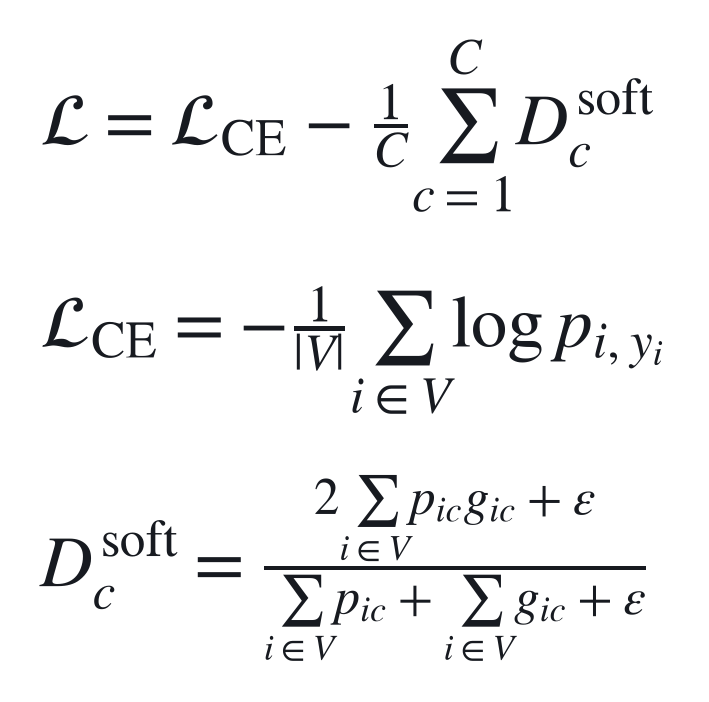
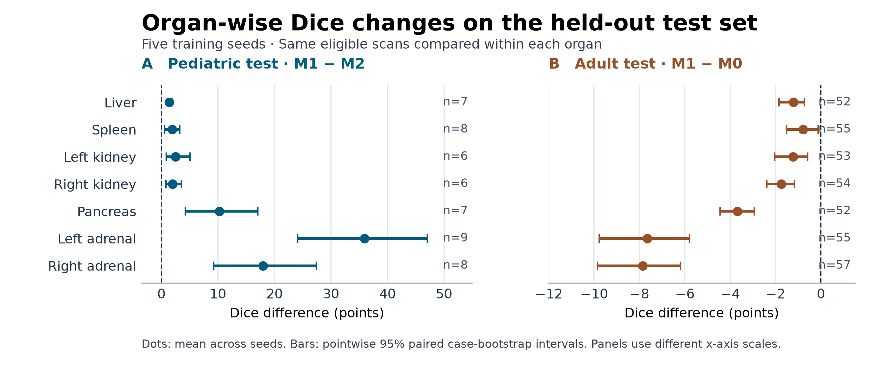
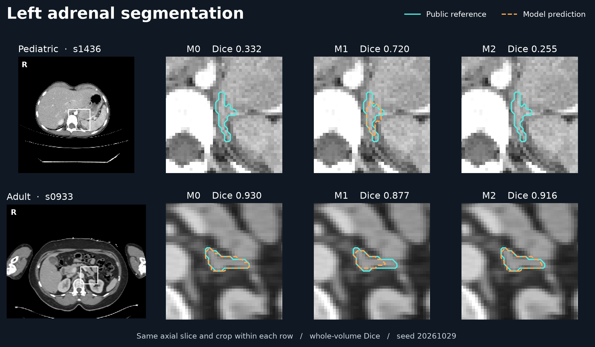
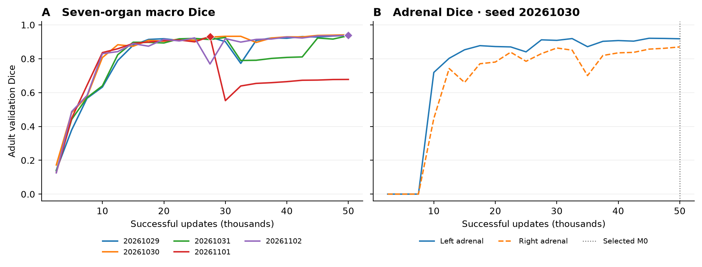

# 성인 CT 기반 복부 분할 모델의 소아 데이터 미세조정 효과에 대한 장기별 이질성 분석

*Organ-Wise Heterogeneity in the Effects of Fine-Tuning Adult-Trained Abdominal CT Segmentation Models on Pediatric Data*

2026학년도 2학기 · 경기대학교 인공지능및응용(EF754) · 5조 Deep Dive

<a name="보고서-작성-안내"></a>

**초록**　본 연구에서는 성인 CT로 학습한 복부 다장기 분할 모델을 동일 예산으로 소아 또는 성인 CT에 미세조정하고, 두 모델의 장기별 분할 성능을 비교하였다. 소아 시험에서 소아 미세조정 모델의 7장기 평균 Dice는 성인 미세조정 모델보다 10.27점 높았다. 장기별 차이는 간 +1.41점에서 좌부신 +35.93점까지 분포하였다. 성인 시험에서는 소아 미세조정 후 기준 모델 대비 평균 Dice가 3.45점 낮아졌다. 두 비교의 방향은 같은 CT로 평가한 다섯 학습 seed에서 일치하였다.

[1. 연구 배경](#1-주제-선정배경) · [2. 실험 방법](#2-ai를-활용한-아이디어-구체화) · [3. 비교군과 지표](#3-비교군-선정과정) · [4. 실험 결과](#4-실험-및-결과) · [5. 결론](#5-결론) · [전체 수치표](#부록) · [자료 다운로드·재현](#실험-자료-다운로드)

## 1. 주제 선정배경

### 1.1 배경 및 필요성

딥러닝 기반 의료영상 분할은 CT에서 해부학적 구조의 위치와 범위를 자동으로 식별하여 장기 부피와 같은 지표를 정량화하는 데 활용된다. Wasserthal 등은 다양한 임상 CT에서 104개 해부학적 구조를 분할하는 TotalSegmentator를 개발하였다. 또한 전신 CT 4,004건을 분석하여 성인 연령대에 따른 일부 해부학적 구조의 부피 및 감쇠값 변화를 보고하였다 [1].

성장과 발달에 따라 소아의 해부학적 특성이 달라지므로, 성인 CT로 학습한 모델을 소아 영상에 적용할 때에는 분할 성능을 별도로 평가할 필요가 있다. Chatterjee 등은 공개 TotalSegmentator를 외부 성인 CT 300건과 소아 CT 359건에 적용하였으며, 평균 Dice는 각각 0.81과 0.73이었다. 양측 부신과 췌장 등에서 소아 Dice가 낮았다. 연구진이 성인 CT로 별도 학습한 nnU-Net을 소아 자료로 미세조정한 결과, 이 모델은 소아 평가에서 공개 TotalSegmentator보다 높은 분할 성능을 보였다 [2].

Chatterjee 등의 비교 설계에는 동일한 성인 기준 모델을 같은 예산으로 성인 CT에 추가 학습하는 대조군이 없었다 [2]. 소아 자료를 사용하는 효과를 평가하려면 동일한 출발점과 학습 예산에서 소아 자료와 성인 자료를 사용한 두 미세조정군을 직접 비교할 필요가 있다. 또한 일부 장기의 큰 개선이 전체 평균을 좌우할 수 있으므로, 전체 평균과 함께 개별 장기의 변화량을 확인해야 한다.

이에 본 연구는 TotalSegmentator CT V3.0.0 [3]에서 **동일 예산의 소아·성인 미세조정 간 성능 차이가 소아 복부 7개 장기에서 얼마나 다르게 나타나는지** 분석하였다. 아울러 소아 미세조정 전후의 성인 시험 성능을 비교하여 소아 적응에 동반된 성인 성능 변화를 평가하였다.

### 1.2 문제 정의

단일 3차원 CT에서 복부 7개 장기를 분할하는 과업을 설정하였다. 표 1에 입력·출력과 주 평가 및 보조 평가 목표를 제시하였다.

**표 1. 분할 과업의 입력·출력과 연구의 평가 목표**

| 항목 | 내용 |
|---|---|
| 입력 | 단일 채널 3차원 CT 영상 한 건. 학습 시 같은 CT의 공개 장기 마스크를 정답으로 사용 |
| 출력 | 원본 CT 격자의 voxel별 분할 마스크. 배경과 간, 비장, 좌·우 신장, 췌장, 좌·우 부신으로 구분 |
| 주 평가 목표 | 소아 시험셋에서 M1−M2의 장기별 Dice 차이를 측정하여, 동일 예산에서 소아 CT를 사용했을 때의 이득이 어느 장기에서 크게 나타나는지 평가 |
| 보조 평가 목표 | 소아 시험셋에서 M1−M0로 미세조정 전후의 차이를 평가하고, 성인 시험셋에서 M1−M0 및 M2−M0로 두 미세조정군의 성인 성능 변화를 평가. 경계 성능은 NSD·HD95로, 반복 학습에 따른 변동은 5개 학습 seed의 결과로 확인 |

### 1.3 중간발표 대비 변경 사항

단일 데이터셋과 동일 예산 대조군은 초기 설계를 유지하였다. 데이터 감사 결과에 따라 미세조정군의 규모를 코호트별 32건으로 확정하고, 촬영 사례 단위로 자료를 분할하였다(표 2).

<details>
<summary>표 2. 초기 계획에서 바뀐 표본 수·분할 단위·반복 횟수와 결정 근거</summary>

| 항목 | 초기 계획 | 최종 실험 | 결정 근거 |
|---|---|---|---|
| 데이터셋·비교군 | TotalSegmentator CT V3, 성인 기준 모델(M0)과 동일 예산의 소아·성인 추가 학습군(M1·M2) | 데이터셋과 세 비교군 유지, 평가 범위는 복부 7개 장기로 확정 | 동일 예산 대조 구조를 유지하고 세 모델을 같은 장기 집합에서 비교 |
| 미세조정 표본 수 | 소아·성인 각 128건(잠정) | 소아·성인 각 32건 | 적격 소아 개발 후보 54건 중 16건을 검증셋에 배정한 뒤, 소아 32건과 성인 32건으로 미세조정군을 구성. 남은 적격 소아 6건은 미배정 |
| 데이터 분할 단위 | 환자 단위 분할 | CT 촬영 사례(case) 단위 분할. 공식 시험셋과 동일한 훈련 측 CT를 제외 | 공개 배포본에서 서로 다른 촬영을 동일 환자로 연결할 식별자를 확인할 수 없었음 |
| 반복 실험 | 한 학습 seed로 시작한 뒤 반복 확대 검토 | 고정된 데이터 분할에서 5개 학습 seed로 반복 | 초기 가중치와 학습 표집의 난수에 따라 모델 간 성능 차이가 얼마나 달라지는지 확인 |
| 평가지표·단위 | Dice·NSD·HD95 | 세 지표 유지. NSD 허용 거리 2 voxel, HD95 단위 voxel | 배포 NIfTI의 물리적 공간 단위를 확인할 수 없어 원본 CT의 voxel 격자에서 거리 계산 |

</details>

## 2. AI를 활용한 아이디어 구체화

### 2.1 전체 구조

CT와 마스크를 표준 RAS 방향으로 재배열하고 원본 해상도를 유지하였다. 일곱 장기의 마스크를 하나의 학습 표적으로 통합하였으며, 둘 이상의 마스크가 겹친 voxel에는 무시값 8을 부여하였다. 강도 정규화 통계는 M0 학습용 성인 CT 577건의 장기 영역에서 건당 최대 100,000 voxel을 표집하여 산출하였다. 학습·검증·시험 전반에서 CT 강도를 −52–275로 제한하고 평균 86.8773, 표준편차 51.5913으로 표준화하였다.

각 학습 seed에서 성인 검증 CT 16건의 macro Dice로 M0를 선정한 후, 동일 가중치에서 M1과 M2를 분기하였다(그림 1). M1·M2는 성인·소아 각 16건의 개발 검증셋을 공유하였다. M0의 소아 검증 점수는 체크포인트를 선정한 후 별도로 산출하였다.


**그림 1. 데이터 분할, 모델 학습 및 공식 시험 절차.** 다섯 학습 seed의 선정 모델 15개를 동일한 공식 시험 CT 108건에서 평가하였다.


**그림 1 보조 영상. 소아 CT의 7장기 분할 예시.** 왼쪽부터 원본 관상면, M1의 예측 마스크를 중첩한 관상면, 후방에서 본 3차원 예측 표면이다. 7장기가 모두 적격인 소아 5건 중 첫 seed(`20261029`)의 M1 평균 Dice가 중앙값인 사례(`s1446`, 0.8603)를 제시하였다. CT·공개 라벨은 Jakob Wasserthal의 배포 자료이며, 예측 및 시각화는 본 연구에서 수행하였다. [원자료](https://doi.org/10.5281/zenodo.22688904) · [CC BY 4.0](https://creativecommons.org/licenses/by/4.0/)

### 2.2 모델 및 학습 설정

TotalSegmentator CT V3.0.0 [3]의 성인 학습군에서 3D PlainConvUNet을 무작위 초기값으로 학습하여 기준 모델 M0를 만들었다. 세 모델에는 같은 네트워크 구조를 사용하였다. nnU-Net의 네트워크 구성·손실·추론 구현을 활용하되 [4], 본 실험의 구조와 학습 조건은 표 3의 값으로 고정하였다.

학습 시도마다 해당 학습군에서 CT 한 건을 균등 복원추출하고, 해당 영상과 정답 마스크에서 3차원 patch 한 쌍을 잘라 사용하였다. 학습 예산은 성공한 optimizer update 수로 정의하였다. 혼합정밀도 학습에서 수치 오버플로로 건너뛴 단계는 업데이트 수와 학습률 일정에 반영하지 않았다.

**표 3. 세 모델의 공통 설정과 분기별 학습 예산**

| 항목 | 설정 |
|---|---|
| 모델 | 3D PlainConvUNet. 입력 1채널, 출력 8클래스(배경과 7개 장기), 단계별 채널 32/64/128/256/320. 최종 출력에만 손실 적용 |
| Patch·batch | 96 × 128 × 128 voxel, batch size 1. 확률 1/3로 장기를 균등 선택한 뒤 해당 장기의 전경 좌표를 기준으로 추출. 확률 2/3로 임의 위치에서 추출 |
| 데이터 증강 | 밝기 → 대비 → Gaussian noise 순서. 밝기와 대비는 각각 확률 0.15로 적용하고 배율은 0.85–1.15에서 균등 추출. 잡음은 확률 0.10으로 적용하고 표준편차는 0–0.1에서 균등 추출. 강도 변환만 적용 |
| 손실 함수 | Cross-entropy에서 7개 장기의 평균 soft Dice를 뺀 값을 최소화. 두 손실 항의 가중치는 각각 1. 배경은 cross-entropy에 포함하고 겹침 voxel은 두 항에서 제외 |
| Optimizer·학습률 | Nesterov SGD, momentum 0.99, weight decay 3×10⁻⁵. 초기 학습률은 M0 0.01, M1·M2 각각 0.001. 성공 update 수를 기준으로 지수 0.9의 다항 감쇠 적용 |
| 학습 예산·모델 선정 | M0는 50,000 updates를 학습하고 2,500 updates마다 성인 검증셋에서 평가. 최고 macro Dice가 처음 기록된 체크포인트를 선정. M1·M2는 각 5,000 updates를 학습하고 1,000 updates마다 성인·소아 검증셋에서 평가. 두 모델 모두 마지막 체크포인트를 사용 |
| 시험 추론 | Sliding window, tile step 0.5. 각 patch의 기본 방향에서 얻은 출력을 Gaussian 가중으로 결합하고, voxel별 최고 점수 클래스를 최종 분할로 사용 |
| 실험 환경 | WSL2, Python 3.12, PyTorch 2.8.0+cu126, nnU-Net v2.8.1, NVIDIA GeForce RTX 3060 Ti, FP16 혼합정밀도 |

**학습 손실함수.** 세 모델 모두 유효 voxel에 대한 cross-entropy에서 전경 7개 장기의 평균 soft Dice를 뺀 값을 최소화하였다. 두 항의 가중치는 각각 1이다.



여기서 <i>C</i> = 7은 전경 장기 수이며, <i>V</i>는 정답 클래스 <i>y</i><sub>i</sub>가 무시값 8이 아닌 voxel의 집합이다. <i>p</i><sub>ic</sub>는 voxel <i>i</i>가 클래스 <i>c</i>에 속할 softmax 예측 확률이고, <i>g</i><sub>ic</sub>는 정답 클래스가 <i>c</i>이면 1, 그 밖에는 0인 지시변수이다. 평활화 상수는 ε = 10⁻⁵이다.

Cross-entropy에는 배경과 7개 전경 장기를 포함하였다. Soft Dice는 전경 장기에 대해서만 평균하였다. 마스크 겹침과 patch 패딩에 해당하는 voxel은 두 항에서 모두 제외하였다. [학습 구현](src/tsv3/training.py#L75)

<details>
<summary>손실함수 LaTeX 원문</summary>

```latex
\[
\mathcal{L} = \mathcal{L}_{\mathrm{CE}} - \frac{1}{C}\sum_{c=1}^{C} D_c^{\mathrm{soft}}
\]

\[
\mathcal{L}_{\mathrm{CE}} = -\frac{1}{\lvert V\rvert}\sum_{i\in V}\log p_{i,y_i}
\]

\[
D_c^{\mathrm{soft}} = \frac{2\sum_{i\in V}p_{ic}g_{ic}+\varepsilon}{\sum_{i\in V}p_{ic}+\sum_{i\in V}g_{ic}+\varepsilon}
\]
```

[기존 수식 이미지](docs/figures/training_loss.png)

</details>

### 2.3 핵심 아이디어

미세조정에 사용한 코호트에 따른 차이를 비교하기 위해 초기 가중치와 학습 예산을 통제하였다. 각 학습 seed에서 선정한 M0의 가중치를 M1과 M2에 똑같이 불러오고, optimizer는 두 모델에서 각각 새로 초기화한 뒤 모든 층을 갱신하였다. M2용 성인 CT 32건을 M0 학습에서 미리 분리하였으므로, 두 모델은 모두 M0 학습에 쓰이지 않은 CT 32건으로 각각 5,000 updates를 수행하였다.

CT 배정을 결정하는 **분할 seed는 20261029로 고정**하였다. 이 분할에서 **학습 seed 20261029, 20261030, 20261031, 20261101, 20261102**별로 M0를 처음부터 학습한 뒤 동일한 절차로 M1과 M2를 구성하였다. 따라서 반복 실험은 같은 데이터 배정에서 가중치 초기화, CT·patch 표집 및 증강의 난수에 따라 모델 간 성능 차이가 얼마나 달라지는지 평가한다. 각 seed에서 M1과 M2가 동일한 선정 M0로 시작하여 정해진 update 수를 마쳤음을 실행 기록과 가중치 해시로 확인하였다.

## 3. 비교군 선정과정

### 3.1 비교군

표 4는 성인 기준 모델과 두 미세조정군의 학습 자료 및 비교 목적을 제시한다.

**표 4. 모델별 학습 자료와 비교 목적**

| 모델 | 학습 자료와 출발점 | 비교 목적 |
|---|---|---|
| M0 · 성인 기준 모델 | 성인 CT 577건으로 처음부터 학습 | 미세조정 전 소아·성인 분할 성능의 기준 |
| M1 · 소아 미세조정 | 선정 M0에서 소아 CT 32건으로 5,000 updates | 소아 CT를 사용한 미세조정군 |
| M2 · 성인 미세조정 | 동일한 선정 M0에서 별도 성인 CT 32건으로 5,000 updates | 동일 예산에서 성인 CT를 사용한 대조군 |

소아 시험셋의 **M1−M2**를 주 비교로 설정하였다. 소아 시험셋의 **M1−M0**는 소아 미세조정 전후의 변화를, 성인 시험셋의 **M1−M0**와 **M2−M0**는 각 미세조정군의 성인 성능 변화를 나타낸다.

### 3.2 평가지표

세 모델의 예측을 원본 CT 격자에서 평가하였다. 주 지표인 **Dice similarity coefficient (Dice)**는 예측 영역과 정답 영역의 겹침을 측정한다 [5]. 장기 경계는 **Normalized Surface Dice (NSD)**와 **95th-percentile Hausdorff distance (HD95)**로 평가하였다. 두 경계 지표는 `surface-distance`로 계산했으며 [6], 정의와 단위는 표 5에 제시하였다.

**표 5. 원본 CT 격자에서 계산한 평가지표**

| 지표 | 정의 | 선정 이유 |
|---|---|---|
| Dice ↑ | 2 × 예측·정답의 교집합 voxel 수 / (예측 voxel 수 + 정답 voxel 수) | 예측과 정답의 장기 영역이 얼마나 겹치는지 평가 |
| NSD ↑ | 예측·정답 양쪽 표면에서 상대 표면과의 거리가 2 voxel 이내인 부분의 면적 비율 | 허용 거리 안에서 경계가 얼마나 일치하는지 평가 |
| HD95 ↓ | 양방향 표면 거리의 면적 가중 95백분위 중 큰 값. 단위는 voxel | 예측 표면의 큰 거리 오차를 평가 |

**평가 대상과 빈 예측.** 기술적 품질관리(QC)를 통과한 CT에서 장기별로 적격 여부를 판정하였다. 해당 장기의 정답 마스크가 비어 있지 않고 영상 경계에 닿지 않는 사례를 주 분석에 포함하였다. 따라서 같은 CT에서도 장기별 적격 여부가 다를 수 있다.

양성 정답에 대한 예측이 비어 있으면 Dice와 NSD는 0으로, HD95는 무한대에 해당하는 실패로 기록하였다. HD95의 모델 간 차이는 다섯 학습 seed 모두에서 두 모델의 HD95가 유한한 공통 CT 사례에 대해 산출하였다. 빈 예측에 따른 실패 횟수도 별도로 집계하였다.

**점수 집계와 불확실성.** 장기별 Dice는 해당 장기의 적격 CT 점수를 평균하여 산출하였다. 이 일곱 장기 평균에 동일한 가중치를 부여하여 macro Dice를 구하였다. 모델 간 차이는 동일 CT에서 짝지어 계산하였다.

장기별 95% bootstrap 구간은 CT 사례에 따른 불확실성을 나타낸다. 각 CT에서 두 모델의 점수 차이를 다섯 seed에 걸쳐 평균한 뒤, 그 차이를 CT 촬영 사례 단위로 10,000회 복원추출하였다. 학습 seed 간 표본 표준편차(SD)는 고정된 분할에서 학습을 반복했을 때의 변동을 나타낸다.

## 4. 실험 및 결과

### 4.1 실험 설정

공식 배포본의 CT 1,939건과 117개 구조의 마스크 226,863개를 점검하였다. 18세 미만을 소아, 18세 이상을 성인으로 분류하였다. 연령 정보, 중복 여부 또는 기술 QC를 근거로 28건을 제외·보류하였다. 공식 훈련셋의 `s1445`와 공식 시험셋의 `s1446`는 동일 CT로 확인되어 훈련 측 `s1445`를 격리하였다. 공식 시험셋 109건 중 연령이 확인된 108건을 최종 평가에 사용하였다.

학습·검증 후보에는 복부 7개 장기의 정답 마스크가 모두 존재하고 영상 경계에 닿지 않는 기준을 적용하였다. 하나 이상의 마스크가 빈 866건과, 7개 모두 존재하나 하나 이상이 경계에 닿은 258건을 제외하였다. 적격 소아 후보 54건 중 32건을 M1 학습, 16건을 검증에 배정하였으며 나머지 6건은 미배정으로 두었다.

**표 6. 코호트별 학습·검증·시험 분할(CT 건수)**

| 코호트 | M0 학습 | M1 미세조정 | M2 미세조정 | 개발 검증셋 | 공식 시험셋 |
|---|---:|---:|---:|---:|---:|
| 소아 | 0 | 32 | 0 | 16 | 20 |
| 성인 | 577 | 0 | 32 | 16 | 88 |
| 합계 | 577 | 32 | 32 | 32 | 108 |

표 6의 학습·검증용 CT 673건은 다섯 seed에서 동일하게 배정하였다. 선정 모델 15개를 공식 시험셋 108건에 적용하여 모델–CT 1,620쌍과 장기 기록 11,340개를 얻었다 [7]. 공식 시험에서는 장기별 적격 기준을 적용하였으며, 소아 주 분석에 실제로 포함된 CT 수는 표 8에 제시하였다.

### 4.2 정량 결과

공식 시험에서 소아 미세조정 모델(M1)의 7장기 균등평균 Dice는 소아 CT에서 동일 예산의 성인 미세조정 모델(M2)보다 높았고, 성인 CT에서는 기준 모델(M0)보다 낮았다(표 7). 두 비교의 방향은 각각 다섯 학습 seed에서 일치하였다.

**표 7. 공식 시험셋의 7개 장기 균등평균 Dice와 모델 간 차이**

| 코호트 | M0 | M1 | M2 | M1−M2, Dice점 | M1−M0, Dice점 | M2−M0, Dice점 |
|---|---:|---:|---:|---:|---:|---:|
| 소아 | 0.7116 | 0.8129 | 0.7102 | +10.27 ± 1.51 | +10.14 ± 2.94 | −0.14 ± 2.06 |
| 성인 | 0.9125 | 0.8780 | 0.9131 | −3.52 ± 0.27 | −3.45 ± 0.34 | +0.06 ± 0.23 |

절대 Dice의 범위는 0–1이며, 모델 간 차이 1점은 Dice 0.01에 해당한다. 차이는 반올림 전 점수로 산출한 다섯 seed의 평균 ± 표본 SD이다. 성인 CT에서 M1−M0는 −3.45점이었으며, 성인 자료로 미세조정한 M2−M0는 +0.06점이었다.

소아 시험에서 미세조정의 이득은 장기에 따라 달랐다. 표 8에 장기별 적격 CT 수, 세 모델의 절대 Dice와 짝지은 차이를 제시하였다.

**표 8. 소아 공식 시험셋의 장기별 Dice와 동일 예산 미세조정 간 차이**

| 장기 | 적격 CT 수 | M0 | M1 | M2 | M1−M2 [95% 구간], 점 | M1−M0, 점 |
|---|---:|---:|---:|---:|---:|---:|
| 간 | 7 | 0.9388 | 0.9526 | 0.9385 | +1.41 [+1.03–+1.87] | +1.39 |
| 비장 | 8 | 0.7966 | 0.8212 | 0.8021 | +1.91 [+0.57–+3.23] | +2.45 |
| 좌신장 | 6 | 0.9342 | 0.9416 | 0.9169 | +2.47 [+0.84–+5.04] | +0.74 |
| 우신장 | 6 | 0.9406 | 0.9525 | 0.9327 | +1.98 [+0.83–+3.54] | +1.19 |
| 췌장 | 7 | 0.6523 | 0.7575 | 0.6552 | +10.23 [+4.26–+17.05] | +10.51 |
| 좌부신 | 9 | 0.2205 | 0.6091 | 0.2498 | +35.93 [+24.08–+47.07] | +38.86 |
| 우부신 | 8 | 0.4980 | 0.6561 | 0.4764 | +17.97 [+9.27–+27.43] | +15.81 |

소아 M1−M2는 간 +1.41점에서 좌부신 +35.93점까지 분포하였다(표 8, 그림 2). 좌부신·우부신·췌장은 다섯 seed 모두에서 이득 상위 세 장기였고, 양측 부신이 7개 장기 이득 합계의 약 75%를 차지하였다. 이득이 가장 큰 좌부신의 M1 절대 Dice는 0.6091이었다. 성인에서는 M1−M0의 다섯 seed 평균이 7개 장기 모두에서 음수였으며, 좌부신(−7.65점)과 우부신(−7.86점)의 하락 폭이 가장 컸다.



**그림 2. 공식 시험의 장기별 변화.** 왼쪽은 소아에서 동일 예산의 두 모델을 비교한 M1−M2, 오른쪽은 성인에서 소아 미세조정 전후를 비교한 M1−M0이다. 점은 5개 seed 평균, 선은 CT 사례를 10,000회 재표집한 장기별 95% 구간이다. 각 패널의 가로축 범위가 다르다.



**그림 2 보조 영상. 소아 및 성인 시험 CT의 좌부신 분할.** 청록 실선은 공개 라벨, 주황 점선은 모델 예측이다. 각 행은 흰 사각형으로 표시한 부위에서 공개 좌부신 면적이 가장 큰 축상면을 같은 배율과 CT 표시 범위로 확대한 것이다. 패널의 Dice는 재추론한 **전체 3차원 좌부신**에서 산출하였다. [CT·공개 라벨 출처](https://doi.org/10.5281/zenodo.22688904)

첫 seed에서 좌부신 적격 사례를 모델 간 차이순으로 정렬하여 각 코호트의 중앙 사례를 선정하였다(소아 M1−M2, 9건 중 5번째 · 성인 M1−M0, 55건 중 28번째). 소아 사례의 좌부신 Dice는 M0 0.332, M1 0.720, M2 0.255였다. 세 CT로 제작한 영상의 모델–장기 Dice 49개를 공식 기록과 대조한 결과 최대 절대 차이는 0.000378이었다.

소아 M1−M2의 평균 NSD는 7개 장기에서 모두 증가했고, 공통 유한쌍으로 계산한 평균 HD95는 6개 장기에서 감소하였다. 비장의 평균 HD95 차이는 +15.04 voxel이었으며 95% 구간(−1.69–+47.60 voxel)은 0을 포함하였다. 소아 주 분석에서 정답이 있는 장기의 빈 예측은 M0 8회, M1 4회, M2 11회였다. 이 횟수는 seed·CT·장기의 조합을 센 값이다.

경계에 닿는 양성 정답까지 포함한 민감도 분석에서는 소아 M1−M2가 +9.77점이었다. 7개 장기 모두 적격인 동일 소아 CT 5건만 사용했을 때는 +10.29점이었다. 두 분석에서 주 비교의 양수 방향이 유지되었다.

### 4.3 학습 과정 및 결과 분석

개발 검증셋(성인·소아 각 16건)에서 소아 M1−M2는 평균 +13.03점, 성인 M1−M0는 −3.33점이었다. 공식 시험에서도 두 비교의 방향이 유지되었다. 개발 검증과 공식 시험은 사례 구성과 마스크 처리 기준이 서로 달랐으므로, 두 단계 사이에서는 변화의 방향을 중심으로 비교하였다.

학습 seed 20261101의 M0는 27,500 updates에서 성인 검증 macro Dice 최고점인 0.9310을 기록하였다(그림 3 왼쪽). 30,000 updates에서 양측 부신의 검증 Dice가 0으로 떨어져 마지막까지 이 수준에 머물렀다. 사전 선정 규칙에 따라 이 seed의 M1과 M2는 27,500 updates의 M0에서 시작하였다. 나머지 네 seed에서는 50,000 updates의 M0가 선정되었다. 해당 급락의 원인은 미확정이며, 그림 3은 학습 진행 중 검증 성능의 변동과 체크포인트 선정 시점을 보여 준다.



**그림 3. 성인 개발 검증 CT 16건에서의 M0 학습 곡선.** 왼쪽의 마름모는 각 seed의 선정 체크포인트이다. 오른쪽은 연속한 두 검증 시점 사이의 부신 Dice 최대 하락 폭(좌·우 중 큰 값)이 가장 작았던 seed `20261030`의 예시이다. 세로 점선은 50,000번째 업데이트에서 선정된 M0를 표시하며, 이때 좌·우 부신 Dice는 각각 0.918과 0.870이었다.

## 5. 결론

### 5.1 요약

동일한 성인 기준 모델에 같은 미세조정 예산을 적용한 결과, 소아 CT를 사용한 모델은 성인 CT를 사용한 모델보다 소아 시험셋의 7개 장기 평균 Dice가 10.27점 높았다. 이득은 두 부신과 췌장에 집중되었으며, 간과 양쪽 신장의 변화는 +1.41–+2.47점이었다. 소아 미세조정 후 성인 시험셋의 평균 Dice는 기준 모델보다 3.45점 낮았다. 다섯 학습 seed에서 방향이 일치한 이 결과는 소아 적응을 평가할 때 장기별 이득과 기존 성인 성능을 함께 살펴볼 필요가 있음을 보여 준다.

### 5.2 한계 및 향후 계획

소아 시험셋은 20건이며 장기별 주 분석 표본은 6–9건이다. 다섯 seed에서 같은 CT를 평가했으므로 seed 간 변동은 이 사례 구성에 조건부이다. 분할 단위는 CT 촬영 사례이며, 환자 식별자가 없어 동일 환자의 다른 촬영이 포함되었을 가능성이 남아 있다. 공개 정답 마스크는 기술 QC를 중심으로 점검하였고, 연령군별 기관 및 촬영 조건 차이도 남을 수 있다. 따라서 이 결과는 해당 코호트에서 관찰한 적응 효과로 해석하였다. 다중비교 보정 전의 95% 구간은 장기별 효과의 불확실성을 나타낸다. 장기 순위는 관찰된 변화량에 근거한 기술적 비교이다.

후속 연구에서는 학습 자료와 환자 단위로 분리된 외부 소아 코호트에서 장기별 이득과 순위를 재검증할 수 있다. 특히 부신과 췌장은 전문가가 경계와 촬영 범위를 확인한 정답으로 효과를 다시 측정할 필요가 있다. 또한 같은 업데이트 예산의 소아·성인 혼합 미세조정군을 추가하여 소아 이득을 유지하면서 성인 성능 저하를 줄일 수 있는지 양쪽 시험셋에서 평가할 수 있다.

## 참고문헌

[1] J. Wasserthal et al., “TotalSegmentator: Robust Segmentation of 104 Anatomic Structures in CT Images,” *Radiology: Artificial Intelligence*, vol. 5, no. 5, e230024, 2023. [DOI](https://doi.org/10.1148/ryai.230024)

[2] D. Chatterjee et al., “Children Are Not Small Adults: Addressing Limited Generalizability of an Adult Deep Learning CT Organ Segmentation Model to the Pediatric Population,” *Journal of Imaging Informatics in Medicine*, vol. 38, no. 3, pp. 1628–1641, 2025. [DOI](https://doi.org/10.1007/s10278-024-01273-w)

[3] J. Wasserthal, “Dataset with segmentations of 117 important anatomical structures in 1939 CT images,” v3.0.0, Zenodo, 2026. [데이터셋](https://doi.org/10.5281/zenodo.22688904)

[4] F. Isensee, P. F. Jaeger, S. A. A. Kohl, J. Petersen, and K. H. Maier-Hein, “nnU-Net: a self-configuring method for deep learning-based biomedical image segmentation,” *Nature Methods*, vol. 18, no. 2, pp. 203–211, 2021. [DOI](https://doi.org/10.1038/s41592-020-01008-z)

[5] L. R. Dice, “Measures of the Amount of Ecologic Association Between Species,” *Ecology*, vol. 26, no. 3, pp. 297–302, 1945. [DOI](https://doi.org/10.2307/1932409)

[6] DeepMind, *surface-distance*, v0.1. [공식 배포 패키지](https://pypi.org/project/surface-distance/0.1/)

[7] Deep Dive, *TotalSegmentator CT V3 pediatric adaptation study*, 실험 원자료 및 평가 결과, v1.0.0-study, 2026. [프로젝트 Release](https://github.com/Laplace-tech/totalsegmentator-v3-pediatric-adaptation/releases/tag/v1.0.0-study)

## 부록

공식 시험과 개발 검증을 구분하여 학습 seed별 절대 점수, 장기별 성능 변화, 경계 지표 및 민감도 분석 결과를 제시하였다. ΔDice는 점 단위(0.01 = 1점)이다.

[고정 연구 설정](configs/study.json) · [학습 코드](src/tsv3/training.py) · [공식 평가 코드](src/tsv3/evaluation.py) · [CT 그림·학습 곡선 생성 코드](scripts/03_render_report_figures.py) · [실험 일지](docs/experiment_log.md) · [중복 CT 제보](https://github.com/wasserth/TotalSegmentator/issues/638)

<details>
<summary>원본 1,939건의 QC·배정 내역</summary>

| 원본 1,939건의 행선지 | 건수 | 처리 |
|---|---:|---|
| QC 단계 제외·보류 | 28 | 연령 미상 15, 100세 초과 보류 3, 정확한 CT 중복 격리 4, 기술 오류 6 |
| 개발군 선정 기준 미충족 · 빈 mask | 866 | 선택한 7장기 중 하나 이상 비어 있음 |
| 개발군 선정 기준 미충족 · 경계 접촉 | 258 | 7장기 모두 양성이지만 하나 이상 경계 접촉 |
| 개발 학습·validation | 673 | M0 577, M1 32, M2 32, 성인·소아 validation 각 16 |
| 적격 소아 development 미배정 | 6 | 적격 소아 후보 54건에서 M1·validation 배정 후 남은 사례 |
| 공식 test 보존 | 108 | 성인 88·소아 20, 공식 test 중 연령 미상 1건은 QC 단계 제외에 포함 |
| **합계** | **1,939** | 역할은 중복되지 않음 |

</details>

<details>
<summary>공식 test · 코호트별 5개 seed의 절대 Dice와 paired 차이</summary>

**소아 · Seed별 7장기 균등평균 Dice**

| Seed | M0 | M1 | M2 | Δ M1−M2 | Δ M1−M0 |
|---|---:|---:|---:|---:|---:|
| 20261029 | 0.7077 | 0.8174 | 0.6940 | +12.34 | +10.97 |
| 20261030 | 0.7300 | 0.8144 | 0.7234 | +9.11 | +8.44 |
| 20261031 | 0.7282 | 0.8137 | 0.7181 | +9.57 | +8.55 |
| 20261101 | 0.6556 | 0.8049 | 0.6909 | +11.40 | +14.93 |
| 20261102 | 0.7363 | 0.8142 | 0.7248 | +8.94 | +7.79 |
| 평균 | 0.7116 | 0.8129 | 0.7102 | +10.27 | +10.14 |

**성인 · Seed별 7장기 균등평균 Dice**

| Seed | M0 | M1 | M2 | Δ M1−M0 | Δ M2−M0 |
|---|---:|---:|---:|---:|---:|
| 20261029 | 0.9119 | 0.8791 | 0.9162 | −3.28 | +0.44 |
| 20261030 | 0.9174 | 0.8797 | 0.9162 | −3.77 | −0.12 |
| 20261031 | 0.9149 | 0.8838 | 0.9155 | −3.10 | +0.07 |
| 20261101 | 0.9048 | 0.8662 | 0.9037 | −3.86 | −0.11 |
| 20261102 | 0.9135 | 0.8811 | 0.9140 | −3.24 | +0.05 |
| 평균 | 0.9125 | 0.8780 | 0.9131 | −3.45 | +0.06 |

| 공식 test 비교 | 평균 Δ | seed 표본 SD | 방향 일치 |
| --- | ---: | ---: | ---: |
| 소아 M1−M2 | +10.27 | 1.51 | 양수 5/5 · 음수 0/5 |
| 소아 M1−M0 | +10.14 | 2.94 | 양수 5/5 · 음수 0/5 |
| 소아 M2−M0 | −0.14 | 2.06 | 양수 1/5 · 음수 4/5 |
| 성인 M1−M0 | −3.45 | 0.34 | 양수 0/5 · 음수 5/5 |
| 성인 M2−M0 | +0.06 | 0.23 | 양수 3/5 · 음수 2/5 |

</details>

<details>
<summary>공식 시험 · 성인 장기별 절대 Dice와 보조 비교 (소아는 본문 표 8)</summary>

**성인 test · 장기별 Dice**

| 장기 | 적격 n | M0 Dice | M1 Dice | M2 Dice | Δ M1−M0 | Δ M2−M0 |
| --- | ---: | ---: | ---: | ---: | ---: | ---: |
| 간 | 52 | 0.9750 | 0.9629 | 0.9754 | −1.21 | +0.04 |
| 비장 | 55 | 0.9605 | 0.9526 | 0.9614 | −0.79 | +0.09 |
| 좌신장 | 53 | 0.9213 | 0.9090 | 0.9215 | −1.22 | +0.02 |
| 우신장 | 54 | 0.9266 | 0.9091 | 0.9209 | −1.75 | −0.58 |
| 췌장 | 52 | 0.9028 | 0.8661 | 0.9016 | −3.68 | −0.12 |
| 좌부신 | 55 | 0.8517 | 0.7752 | 0.8543 | −7.65 | +0.27 |
| 우부신 | 57 | 0.8494 | 0.7708 | 0.8567 | −7.86 | +0.73 |

</details>

<details>
<summary>소아 장기별 주 비교와 성인 변화의 seed별 수치</summary>

**소아 M1−M2 · Dice점**

| 장기 | 20261029 | 20261030 | 20261031 | 20261101 | 20261102 |
| --- | ---: | ---: | ---: | ---: | ---: |
| 간 | +1.54 | +1.27 | +1.25 | +1.47 | +1.54 |
| 비장 | +2.05 | −0.61 | +1.76 | +5.86 | +0.49 |
| 좌신장 | +7.33 | +0.63 | +2.25 | +1.23 | +0.91 |
| 우신장 | +1.58 | +1.88 | +1.00 | +2.97 | +2.49 |
| 췌장 | +10.17 | +9.35 | +10.33 | +11.95 | +9.35 |
| 좌부신 | +45.67 | +32.04 | +36.38 | +31.17 | +34.38 |
| 우부신 | +18.04 | +19.19 | +14.00 | +25.19 | +13.45 |

**성인 M1−M0 · Dice점**

| 장기 | 20261029 | 20261030 | 20261031 | 20261101 | 20261102 |
| --- | ---: | ---: | ---: | ---: | ---: |
| 간 | −1.35 | −1.18 | −1.12 | −1.23 | −1.15 |
| 비장 | −1.33 | −0.90 | −1.79 | +1.15 | −1.07 |
| 좌신장 | −0.38 | −1.43 | −1.89 | −1.11 | −1.30 |
| 우신장 | −1.42 | −2.08 | −1.88 | −1.04 | −2.35 |
| 췌장 | −4.74 | −3.84 | −3.58 | −3.18 | −3.04 |
| 좌부신 | −7.02 | −8.84 | −6.26 | −10.03 | −6.11 |
| 우부신 | −6.71 | −8.13 | −5.21 | −11.59 | −7.66 |

</details>

<details>
<summary>NSD·HD95 및 민감도 분석 표</summary>

ΔNSD는 0–1 비율의 차이이며 양수가 개선이다. ΔHD95는 voxel 단위이며 음수가 개선이다. HD95의 n은 해당 비교의 공통 유한쌍 수다.

| 장기 | 소아 ΔNSD M1−M2 | 소아 ΔHD95 M1−M2 | 소아 HD95 n | 성인 ΔNSD M1−M0 | 성인 ΔHD95 M1−M0 | 성인 HD95 n |
| --- | ---: | ---: | ---: | ---: | ---: | ---: |
| 간 | +0.0404 | −6.42 | 7 | −0.0188 | +2.50 | 52 |
| 비장 | +0.0034 | +15.04 | 8 | −0.0097 | +8.73 | 55 |
| 좌신장 | +0.0191 | −0.86 | 6 | −0.0079 | −4.19 | 53 |
| 우신장 | +0.0341 | −11.28 | 6 | −0.0012 | −4.44 | 53 |
| 췌장 | +0.1355 | −2.66 | 6 | −0.0286 | −2.09 | 52 |
| 좌부신 | +0.3540 | −5.67 | 6 | −0.0416 | −0.03 | 55 |
| 우부신 | +0.1618 | −1.48 | 6 | −0.0403 | +0.71 | 55 |

소아 주 분석의 빈 예측은 M0 / M1 / M2 각각 **8 / 4 / 11회**였다. M2에서 M1으로 비교하면 실패→유한 8회, 유한→실패 1회, 양쪽 실패 3회다. 횟수는 seed–case–장기 조합 기준이다.

| 평가 기준 | 소아 Δ M1−M2 | 성인 Δ M1−M0 |
| --- | ---: | ---: |
| 주 분석 · nonempty·no-border | +10.27 | −3.45 |
| 경계 접촉 포함 · 모든 nonempty | +9.77 | −3.51 |
| 7장기 모두 적격인 동일 CT · 소아 5건 / 성인 49건 | +10.29 | −3.31 |

</details>

<details>
<summary>Development validation · 5개 seed의 전체 Dice</summary>

**소아 · Seed별 7장기 균등평균 Dice**

| Seed | M0 | M1 | M2 | Δ M1−M2 | Δ M1−M0 |
|---|---:|---:|---:|---:|---:|
| 20261029 | 0.7054 | 0.8176 | 0.6749 | +14.27 | +11.22 |
| 20261030 | 0.7093 | 0.8195 | 0.7009 | +11.85 | +11.02 |
| 20261031 | 0.7023 | 0.8172 | 0.6870 | +13.02 | +11.50 |
| 20261101 | 0.6526 | 0.8122 | 0.6717 | +14.04 | +15.95 |
| 20261102 | 0.7124 | 0.8153 | 0.6955 | +11.99 | +10.30 |
| 평균 | 0.6964 | 0.8164 | 0.6860 | +13.03 | +12.00 |

**성인 · Seed별 7장기 균등평균 Dice**

| Seed | M0 | M1 | M2 | Δ M1−M0 | Δ M2−M0 |
|---|---:|---:|---:|---:|---:|
| 20261029 | 0.9374 | 0.9053 | 0.9383 | −3.21 | +0.10 |
| 20261030 | 0.9414 | 0.9104 | 0.9425 | −3.10 | +0.11 |
| 20261031 | 0.9360 | 0.9041 | 0.9335 | −3.19 | −0.25 |
| 20261101 | 0.9310 | 0.8920 | 0.9341 | −3.91 | +0.31 |
| 20261102 | 0.9379 | 0.9054 | 0.9376 | −3.25 | −0.03 |
| 평균 | 0.9368 | 0.9034 | 0.9372 | −3.33 | +0.05 |

</details>

개발 validation의 첫 seed에서 좌신장 M1−M2는 +15.28점, M1−M0는 +3.41점으로 M2와 M0의 기준 점수 차이가 컸다. 세 번째 seed에서는 M0 우부신, 다섯 번째 seed에서는 M0 좌부신의 validation Dice가 후반에 급락한 뒤 회복했다. [실험 이력](docs/experiment_log.md)

소아 공식 test 7장기를 대상으로 미세조정 전후 차이(M1−M0)와의 Spearman 순위상관을 탐색했다. 장기별 평균 정답 voxel 수와의 ρ는 −0.643, M0 Dice와의 ρ는 −0.893이었다. 좌우 장기가 연관되어 있고 M0는 차이 계산에도 들어가므로, 장기 크기나 초기 성능이 개선의 원인인지 판단하기는 어렵다. 원자료는 `summary.json`의 `pediatric_exploratory_analysis`에 있다.

## 실험 자료 다운로드

**표와 그림의 수치를 확인하려면 [16 MB 결과 자료](https://github.com/Laplace-tech/totalsegmentator-v3-pediatric-adaptation/releases/download/v1.0.0-study/tsv3-experiment-evidence.tar.gz)를 내려받는다.** 전체 자산은 [최종 실험 Release](https://github.com/Laplace-tech/totalsegmentator-v3-pediatric-adaptation/releases/tag/v1.0.0-study)에 있다. 배포한 선정 모델 15개와 재개·이관 체크포인트 13개는 seed별 tar에 보존했다.

| 압축을 푼 뒤 경로 | 들어 있는 내용 |
|---|---|
| `outputs/test_abdominal_v1/report.md` | 주 비교와 보조 비교의 장기별 Dice·NSD·HD95 표, bootstrap 구간 |
| `outputs/test_abdominal_v1/summary.json` | 전 지표의 seed별·장기별 결과, 적격 분모, 빈 예측 전이, 민감도 분석. `per_seed_mean`은 `seeds` 배열 순서다. |
| `outputs/test_abdominal_v1/scores.sqlite` | 공식 test case×모델×장기 원점수 |
| `outputs/training_abdominal_v1_seed20261102/replication_validation.json` | 5개 seed development validation 집계 및 checkpoint 검증 기록 |
| `outputs/training_abdominal_v1_seed*/` | seed별 실행 로그·설정·validation 기록·실행 코드 스냅샷 |
| `manifests/` | 파일 감사, QC, 공개 라벨 검토, 고정 split, 장기별 test eligibility와 metric 계약 |
| `data/preprocessed/` | 개발 cache manifest, 실제 정규화 값, 배열 검증 기록 |

<details>
<summary>연구 재현·그림 생성 및 파일 해시 확인</summary>

공식 평가를 재현하려면 클론 루트에 evidence, 다섯 checkpoint tar, SHA256SUMS.txt를 내려받는다. 평가를 다시 실행한다면 [공식 원본 CT·라벨](https://doi.org/10.5281/zenodo.22688904)을 `data/raw/Totalsegmentator_dataset_v300/`에 둔다. 공식 test는 원본 CT와 선정 모델을 사용하며, fast cache 배열은 재학습할 때 재생성할 수 있다.

~~~bash
sha256sum -c SHA256SUMS.txt --ignore-missing
tar -xzf tsv3-experiment-evidence.tar.gz
# 내려받은 seed별 가중치 아카이브를 각각 복원
for seed in 20261029 20261030 20261031 20261101 20261102; do
  tar -xf "tsv3-checkpoints-${seed}.tar" || exit 1
done
uv sync --frozen --extra training --extra review --extra evaluation
.venv/bin/python -m unittest discover -s tests -q

# 선정 체크포인트 15개와 공식 평가 입력 계약 확인
.venv/bin/python -m tsv3.evaluation --preflight
# README의 CT 그림 2장과 M0 학습 곡선 생성 (CUDA, 공식 점수와 대조)
.venv/bin/python scripts/03_render_report_figures.py --output outputs/report_figures
# 필요할 때 원본 결과와 다른 폴더에 공식 test 재현
.venv/bin/python -u -m tsv3.evaluation --official-test --output outputs/test_abdominal_v1_reproduction
# 재학습용 cache를 복원할 경우
.venv/bin/python -u -m tsv3.preprocessing --output data/preprocessed/abdominal_v1_rebuilt
.venv/bin/python -u -m tsv3.fast_cache --source data/preprocessed/abdominal_v1_rebuilt --output data/preprocessed/abdominal_v1_fast_rebuilt
~~~

소스와 실행 당시 provenance는 [최종 태그의 상세 실험 기록 및 명령](https://github.com/Laplace-tech/totalsegmentator-v3-pediatric-adaptation/blob/v1.0.0-study/README.md), [실험 일지](docs/experiment_log.md), evidence의 seed별 source snapshot에서 확인할 수 있다.

</details>
