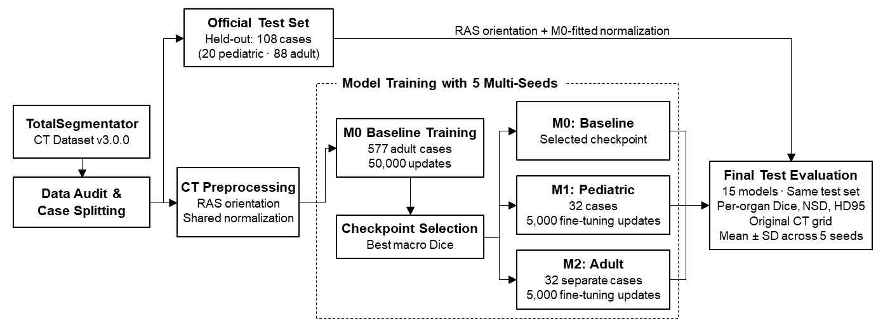
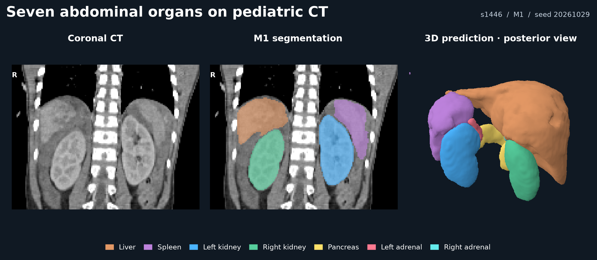

# 성인 CT 기반 복부 분할 모델의 소아 데이터 미세조정 효과에 대한 장기별 이질성 분석

*Organ-Wise Heterogeneity in the Effects of Fine-Tuning Adult-Trained Abdominal CT Segmentation Models on Pediatric Data*

2026학년도 2학기 · 경기대학교 인공지능및응용(EF754) · 5조 Deep Dive

[1. 연구 배경](#1-주제-선정배경) · [2. 실험 방법](#2-ai를-활용한-아이디어-구체화) · [3. 비교군과 지표](#3-비교군-선정과정) · [4. 실험 결과](#4-실험-및-결과) · [5. 결론](#5-결론) · [전체 수치표](#부록) · [자료 다운로드·재현](#실험-자료-다운로드)

## 1. 주제 선정배경

### 1.1 배경 및 필요성

CT 다장기 분할은 한 영상에서 여러 장기의 위치와 부피를 정량화하는 기술이다. Wasserthal 등은 TotalSegmentator로 CT의 해부학적 구조 104개를 자동 분할하였다 [1]. 그러나 Chatterjee 등이 공개 모델을 평가한 결과, 평균 Dice는 성인 CT 300건에서 0.81, 소아 CT 359건에서 0.73이었다. 특히 부신과 췌장에서 차이가 컸다 [2].

선행연구는 소아 자료로 미세조정한 모델의 개선을 보고했지만, 같은 예산으로 성인 자료를 추가 학습하는 대조군은 두지 않았다 [2]. 본 연구는 TotalSegmentator CT V3.0.0 [3]에서 **추가 학습에 소아 CT를 썼을 때 어느 장기가 얼마나 더 개선되는가**를 묻는다. 소아 적응 후 기존 성인 성능이 얼마나 유지되는지도 함께 평가한다.

### 1.2 문제 정의

성인 기준 모델(M0)에서 출발해 소아 미세조정 모델(M1)과 성인 미세조정 모델(M2)을 학습하고, 같은 시험 CT에서 예측을 비교하였다.

**표 1. 모델의 입력·출력과 연구 목표**

| 항목 | 내용 |
|---|---|
| 입력 | 단일 채널 3차원 CT 한 건 |
| 출력 | 원본 격자에서 배경과 복부 7장기(간, 비장, 좌·우 신장, 췌장, 좌·우 부신)를 구분한 마스크 |
| 주 평가 | 소아 시험 CT에서 장기별 M1−M2 Dice 차이 |
| 보조 평가 | 미세조정 전후의 소아·성인 성능, 장기 경계 오차, 학습 seed 간 변동 |

### 1.3 중간발표 대비 변경 사항

단일 데이터셋과 동일 예산 대조 설계는 유지하고, 데이터 감사 결과에 따라 표본 수와 분할 단위를 확정했다.

**표 2. 초기 계획과 최종 실험**

| 항목 | 초기 계획 | 최종 결정과 이유 |
|---|---|---|
| 미세조정 규모 | 소아·성인 각 128건(잠정) | 각 32건. 적격 소아 54건 중 검증 16건을 확보하고 6건은 미배정 |
| 분할 단위 | 환자 | CT 촬영 사례. 공개 자료에 서로 다른 촬영을 연결할 환자 식별자가 없음 |
| 반복 학습 | 1회로 시작 | 같은 분할에서 5개 seed로 학습하여 난수에 따른 변동 확인 |
| 경계 지표 | NSD·HD95 | 원본 NIfTI의 물리적 단위가 불명확하여 voxel 단위로 확정 |

## 2. AI를 활용한 아이디어 구체화

### 2.1 전체 구조

각 seed에서 성인 CT로 M0를 학습한 뒤, 선정된 가중치에서 M1과 M2를 분기했다. 개발 검증을 마친 세 모델을 동일한 공식 시험 CT에 적용했다(그림 1).

**그림 1. 데이터 분할부터 공식 시험까지의 실험 설계.** M0는 성인 검증 CT 16건에서 선정했다. M1·M2는 성인·소아 각 16건의 검증셋을 공유했다. M0의 소아 검증 점수는 선정 후 별도로 구했다.

그림 2는 모델의 출력을 보여준다. 한 단면의 예측을 CT 위에 겹치면 장기 경계를 확인할 수 있고, 전체 마스크를 이용하면 장기들의 공간적 관계를 볼 수 있다.

**그림 2. 소아 CT 원본, M1의 관상면 분할, 뒤에서 본 3차원 예측.** 7장기 모두 적격인 소아 5건 중 첫 seed의 M1 평균 Dice가 중앙인 사례를 표시했다(`s1446`, 0.8603). CT·공개 라벨은 Jakob Wasserthal이 배포했으며, 예측과 시각화는 본 연구에서 수행했다. [원자료](https://doi.org/10.5281/zenodo.22688904) · [CC BY 4.0](https://creativecommons.org/licenses/by/4.0/)

### 2.2 모델 및 학습 설정

nnU-Net v2의 구성 요소 [4]로 3D PlainConvUNet을 구현하고 성인 학습군에서 무작위 초기값으로 M0를 학습했다. CT는 RAS 방향으로 재배열하고 원본 해상도를 유지했다. 강도 정규화에는 M0 학습 CT 577건에서 산출한 동일한 통계를 모든 모델과 시험 CT에 적용했다.

**표 3. 모델·학습·추론 설정**

| 항목 | 설정 |
|---|---|
| 네트워크 | 입력 1채널, 출력 8클래스. 단계별 채널 32/64/128/256/320 |
| 표집·증강 | CT 균등 복원추출. patch 96 × 128 × 128, batch 1. 장기 전경 중심 표집 확률 1/3. 밝기·대비·Gaussian noise 증강 |
| 손실 | Cross-entropy − 전경 7장기의 평균 soft Dice. 가중치 1:1. 마스크 겹침·패딩 voxel 제외 |
| 최적화 | Nesterov SGD, momentum 0.99, weight decay 3×10⁻⁵. 초기 학습률 M0 0.01, M1·M2 0.001. 성공 업데이트 기준 다항 감쇠(지수 0.9) |
| 검증·선정 | M0는 2,500 updates마다 성인 검증 후 최고 macro Dice의 첫 체크포인트 선정. M1·M2는 1,000 updates마다 양 코호트를 검증하고 마지막 체크포인트 사용 |
| 시험 추론 | Sliding window, tile step 0.5, Gaussian 가중 결합. 원본 CT 격자로 예측 복원 |
| 환경 | WSL2, Python 3.12, PyTorch 2.8.0+cu126, nnU-Net v2.8.1, RTX 3060 Ti, FP16 혼합정밀도 |

### 2.3 핵심 아이디어

M2용 성인 32건은 M0 학습 전에 따로 확보했다. 이로써 M1과 M2는 같은 가중치에서 시작해 각각 **처음 보는 CT 32건으로 5,000회** 업데이트했다. 두 모델 모두 optimizer를 새로 초기화하고 모든 층을 미세조정했다.

CT 배정을 결정하는 분할 seed는 `20261029`로 고정했다. 다섯 학습 seed로 반복하여 초기 가중치와 표집·증강의 난수에 따른 변동을 측정했다.

## 3. 비교군 선정과정

### 3.1 비교군

**표 4. 모델별 학습 자료와 비교 목적**

| 모델 | 학습 자료와 출발점 | 비교 목적 |
|---|---|---|
| M0 · 성인 기준 모델 | 성인 CT 577건으로 처음부터 50,000 updates | 미세조정 전 소아·성인 분할 성능의 기준 |
| M1 · 소아 미세조정 | 선정 M0에서 소아 CT 32건으로 5,000 updates | 소아 CT를 사용한 미세조정군 |
| M2 · 성인 미세조정 | 동일한 선정 M0에서 별도 성인 CT 32건으로 5,000 updates | 동일 예산에서 성인 CT를 사용한 대조군 |

소아 시험셋의 **M1−M2**를 주 비교로 설정하였다. 소아 시험셋의 **M1−M0**는 소아 미세조정 전후의 변화를, 성인 시험셋의 **M1−M0**와 **M2−M0**는 각 미세조정군의 성인 성능 변화를 나타낸다.

### 3.2 평가지표

세 모델의 예측을 동일한 원본 CT 격자에서 평가하였다. 장기 영역의 중첩을 평가하는 Dice [5]를 주 지표로 사용하고, 경계 일치도와 큰 경계 오차를 각각 NSD와 HD95로 평가하였다. 두 경계 지표에는 `surface-distance` 구현을 사용하였다 [6].

**표 5. 원본 CT 격자에서 계산한 평가지표**

| 지표 | 정의 | 선정 이유 |
|---|---|---|
| Dice ↑ | 2 × 예측·정답의 교집합 voxel 수 / (예측 voxel 수 + 정답 voxel 수) | 예측과 정답의 장기 영역이 얼마나 겹치는지 평가 |
| NSD ↑ | 예측·정답 양쪽 표면에서 상대 표면과의 거리가 2 voxel 이내인 부분의 면적 비율 | 허용 거리 안에서 경계가 얼마나 일치하는지 평가 |
| HD95 ↓ | 양방향 표면 거리의 면적 가중 95백분위 중 큰 값. 단위는 voxel | 예측 표면의 큰 거리 오차를 평가 |

주 분석에는 기술 QC를 통과한 CT 중 해당 장기의 정답 마스크가 비어 있지 않고 영상 경계에 닿지 않는 사례를 포함하였다. 정답이 있는데 예측이 비어 있으면 Dice·NSD는 0으로, HD95는 무한대에 해당하는 실패로 기록하였다. HD95의 모델 간 차이는 다섯 seed 모두에서 두 모델의 거리가 유한한 공통 사례로 계산하였으며, 빈 예측에 따른 실패 횟수도 집계하였다.

각 장기 점수는 적격 CT별 점수의 평균이고, macro Dice는 이 7개 장기 평균의 균등평균이다. 모델 차이는 동일 CT에서 짝지어 계산하였다. 장기별 95% 구간은 각 CT의 짝지은 차이를 다섯 seed에 걸쳐 평균한 뒤, CT 촬영 사례 단위로 10,000회 재표집하여 구하였다. 학습 seed 간 표본 표준편차(SD)는 같은 데이터 분할에서 학습을 반복했을 때의 변동을 나타낸다.

## 4. 실험 및 결과

### 4.1 실험 설정

공개 CT 1,939건에서 연령, 중복, 영상·마스크 정합성을 점검하고 18세 미만을 소아로 분류했다. 공식 시험 CT `s1446`과 동일한 훈련 측 CT `s1445`는 격리했다. 학습·검증에는 7장기 마스크가 모두 존재하고 촬영 경계에 닿지 않는 사례를 배정했다. 공식 시험에서는 장기별로 이 기준을 적용해 촬영 범위가 제한된 CT도 적격 장기 평가에 포함했다.

**표 6. 코호트별 학습·검증·시험 분할(CT 건수)**

| 코호트 | M0 학습 | M1 미세조정 | M2 미세조정 | 개발 검증셋 | 공식 시험셋 |
|---|---:|---:|---:|---:|---:|
| 소아 | 0 | 32 | 0 | 16 | 20 |
| 성인 | 577 | 0 | 32 | 16 | 88 |
| 합계 | 577 | 32 | 32 | 32 | 108 |

동일한 분할에서 학습한 모델 15개(5개 seed × 3개 모델)를 공식 시험 CT 108건에 적용했다 [7]. 소아의 장기별 적격 사례는 6–9건이었다.

### 4.2 정량 결과

소아 시험에서 M1은 동일 예산의 M2보다 7장기 평균 Dice가 높았다. 성인 시험에서는 M1이 기준 모델 M0보다 낮았다. 두 변화의 방향은 각각 다섯 seed 모두에서 일치했다.

**표 7. 공식 시험의 7장기 평균 Dice와 코호트별 핵심 비교**

| 시험 코호트 | M0 | M1 | M2 | 비교 | 차이, Dice점 |
|---|---:|---:|---:|---|---:|
| 소아 | 0.7116 | 0.8129 | 0.7102 | M1−M2 | **+10.27 ± 1.51** |
| 성인 | 0.9125 | 0.8780 | 0.9131 | M1−M0 | **−3.45 ± 0.34** |

절대 Dice는 0–1이고 차이 1점은 Dice 0.01이다. ±는 다섯 학습 seed 간 표본 표준편차다. 성인 자료로 미세조정한 M2의 성인 성능 변화(M2−M0)는 +0.06점이었다.

**표 8. 소아 시험에서 장기별 절대 Dice와 동일 예산 미세조정의 차이**

| 장기 | 적격 CT 수 | M0 | M1 | M2 | M1−M2 [95% 구간], 점 |
|---|---:|---:|---:|---:|---:|
| 간 | 7 | 0.9388 | 0.9526 | 0.9385 | +1.41 [+1.03–+1.87] |
| 비장 | 8 | 0.7966 | 0.8212 | 0.8021 | +1.91 [+0.57–+3.23] |
| 좌신장 | 6 | 0.9342 | 0.9416 | 0.9169 | +2.47 [+0.84–+5.04] |
| 우신장 | 6 | 0.9406 | 0.9525 | 0.9327 | +1.98 [+0.83–+3.54] |
| 췌장 | 7 | 0.6523 | 0.7575 | 0.6552 | +10.23 [+4.26–+17.05] |
| 좌부신 | 9 | 0.2205 | 0.6091 | 0.2498 | +35.93 [+24.08–+47.07] |
| 우부신 | 8 | 0.4980 | 0.6561 | 0.4764 | +17.97 [+9.27–+27.43] |

소아에서 이득이 가장 컸던 장기는 좌부신(+35.93점)이었고, 우부신(+17.97점)과 췌장(+10.23점)이 뒤를 이었다. 간의 차이는 +1.41점이었다. 좌부신은 크게 개선된 뒤에도 M1의 절대 Dice가 0.6091이었다. 성인에서는 양측 부신의 M1−M0 하락 폭이 가장 컸다(그림 3).

**그림 3. 공식 시험에서의 장기별 Dice 변화.** 왼쪽은 소아 M1−M2, 오른쪽은 성인 M1−M0이다. 점은 다섯 seed 평균, 선은 CT 사례 단위 paired bootstrap 95% 구간이다. 두 패널의 가로축 범위가 다르다.

**그림 4. 같은 좌부신의 모델별 예측.** 청록 실선은 공개 라벨, 주황 점선은 예측이다. 첫 seed의 적격 CT 중 소아 M1−M2와 성인 M1−M0가 각각 중앙인 사례를 골랐다. 각 행은 같은 축상면을 보여주며, 표시한 Dice는 전체 3차원 좌부신에서 계산했다. [CT·라벨 출처](https://doi.org/10.5281/zenodo.22688904)

소아 사례(그림 4 위)에서 M1은 공개 좌부신 윤곽의 일부를 포착했고, 전체 좌부신 Dice는 M0 0.332, M1 0.720, M2 0.255였다. 전체 소아 시험의 경계 지표에서도 M1−M2의 평균 NSD는 7장기 모두에서 증가했고, 공통 유한쌍의 평균 HD95는 6개 장기에서 감소했다.

### 4.3 학습 과정 및 결과 분석

개발 검증에서도 소아 M1−M2는 +13.03점, 성인 M1−M0는 −3.33점이었다. 그림 5에서 네 seed의 M0는 50,000 updates에 선정됐다. 나머지 seed `20261101`은 27,500 updates에서 최고점(0.9310)을 기록한 뒤 30,000 updates부터 양측 부신 Dice가 0에 머물렀다. 이 seed의 두 미세조정 모델은 사전 규칙에 따라 27,500번째 가중치에서 출발했다. 급락 원인은 확인되지 않았다.

**그림 5. 성인 개발 검증 CT 16건에서의 M0 학습 곡선.** 왼쪽 마름모는 다섯 seed 각각의 선정 시점이다. 오른쪽은 연속 검증 사이 양측 부신 Dice의 최대 하락 폭이 가장 작았던 seed `20261030`의 예시다.

## 5. 결론

### 5.1 요약

동일 예산에서 소아 CT로 미세조정했을 때 소아 분할 이득은 양측 부신과 췌장에 집중됐다. 동시에 성인에서는 7개 장기 모두에서 다섯 seed 평균 Dice가 낮아졌다. 이 코호트에서 소아 적응의 효과를 판단하려면 개선된 장기와 기존 성인 성능을 함께 살펴야 한다.

### 5.2 한계 및 향후 계획

소아 시험의 장기별 표본은 6–9건이며 다섯 seed는 같은 CT를 반복 평가했다. 장기별 95% 구간은 다중비교를 보정하지 않았다. 환자 식별자 부재, 공개 라벨의 제한된 수동 검수, 연령군 간 촬영 조건 차이도 해석 범위를 제한한다.

후속 연구에서는 환자 단위로 분리한 외부 소아 코호트에서 장기별 효과를 검증하고, 동일 예산의 성인·소아 혼합 미세조정이 성인 성능 저하를 줄일 수 있는지 평가할 수 있다.

## 참고문헌

[1] J. Wasserthal et al., “TotalSegmentator: Robust Segmentation of 104 Anatomic Structures in CT Images,” *Radiology: Artificial Intelligence*, vol. 5, no. 5, e230024, 2023. [DOI](https://doi.org/10.1148/ryai.230024)

[2] D. Chatterjee et al., “Children Are Not Small Adults: Addressing Limited Generalizability of an Adult Deep Learning CT Organ Segmentation Model to the Pediatric Population,” *Journal of Imaging Informatics in Medicine*, vol. 38, no. 3, pp. 1628–1641, 2025. [DOI](https://doi.org/10.1007/s10278-024-01273-w)

[3] J. Wasserthal, “Dataset with segmentations of 117 important anatomical structures in 1939 CT images,” v3.0.0, Zenodo, 2026. [데이터셋](https://doi.org/10.5281/zenodo.22688904)

[4] F. Isensee, P. F. Jaeger, S. A. A. Kohl, J. Petersen, and K. H. Maier-Hein, “nnU-Net: a self-configuring method for deep learning-based biomedical image segmentation,” *Nature Methods*, vol. 18, no. 2, pp. 203–211, 2021. [DOI](https://doi.org/10.1038/s41592-020-01008-z)

[5] L. R. Dice, “Measures of the Amount of Ecologic Association Between Species,” *Ecology*, vol. 26, no. 3, pp. 297–302, 1945. [DOI](https://doi.org/10.2307/1932409)

[6] DeepMind, *surface-distance*, v0.1. [공식 배포 패키지](https://pypi.org/project/surface-distance/0.1/)

[7] Deep Dive, *TotalSegmentator CT V3 pediatric adaptation study*, 실험 원자료 및 평가 결과, v1.0.0-study, 2026. [프로젝트 Release](https://github.com/Laplace-tech/totalsegmentator-v3-pediatric-adaptation/releases/tag/v1.0.0-study)

## 부록

아래 표에서 학습 seed별 절대 점수, 성인 장기별 변화, 경계 지표와 민감도 분석을 확인할 수 있다. 공식 시험과 개발 검증을 각각 표시했다. ΔDice는 점 단위(0.01 = 1점)이다.

[고정 연구 설정](configs/study.json) · [학습 코드](src/tsv3/training.py) · [공식 평가 코드](src/tsv3/evaluation.py) · [CT 그림·학습 곡선 생성 코드](scripts/03_render_report_figures.py) · [실험 일지](docs/experiment_log.md) · [중복 CT 제보](https://github.com/wasserth/TotalSegmentator/issues/638)

전처리·증강 세부값과 그림 검산

- M0 학습 CT의 장기 영역에서 건당 최대 100,000 voxel을 표집했다. CT 강도를 [−52, 275]로 제한하고 평균 86.8773, 표준편차 51.5913으로 표준화했다.
- 밝기와 대비는 각각 확률 0.15로 배율 0.85–1.15를, Gaussian noise는 확률 0.10으로 표준편차 0–0.1을 적용했다. 혼합정밀도 오버플로로 건너뛴 업데이트는 예산과 학습률 일정에서 제외했다.
- 그림 2·4는 첫 학습 seed(`20261029`)의 선정 가중치로 재추론했다. 그림 생성에 쓰인 모델–CT–장기 Dice 49개와 공식 기록의 최대 절대 차이는 0.000378이었다. 표 7·8에는 원래의 공식 시험 점수를 사용했다.

손실함수 수식과 기호 정의

M0·M1·M2에 같은 손실함수를 적용하였다.

$$
\mathcal{L} = \mathcal{L}_{\mathrm{CE}} - \frac{1}{C}\sum_{c=1}^{C} D_c^{\mathrm{soft}}
$$

$$
\mathcal{L}_{\mathrm{CE}} = -\frac{1}{\lvert V\rvert}\sum_{i\in V}\log p_{i,y_i}
$$

$$
D_c^{\mathrm{soft}} = \frac{2\sum_{i\in V}p_{ic}g_{ic}+\varepsilon}{\sum_{i\in V}p_{ic}+\sum_{i\in V}g_{ic}+\varepsilon}
$$

여기서 $C=7$은 전경 장기 수, $V$는 정답 클래스 $y_i$가 8이 아닌 voxel $i$의 집합이다. $p_{ic}$는 클래스 $c$의 softmax 예측 확률, $g_{ic}=\mathbf{1}[y_i=c]$는 해당 클래스의 이진 정답 표시이며, $\varepsilon=10^{-5}$는 평활화 상수이다. 장기 마스크가 겹치거나 patch를 패딩한 위치에는 값 8을 부여하여 두 손실 항에서 제외하였다. Cross-entropy는 배경과 7개 장기를 포함하고, Soft Dice는 7개 전경 장기의 점수를 평균하였다. [수식 이미지](docs/figures/training_loss.png) · [학습 구현](src/tsv3/training.py#L75)

원본 1,939건의 QC·배정 내역

| 원본 1,939건의 행선지 | 건수 | 처리 |
|---|---:|---|
| QC 단계 제외·보류 | 28 | 연령 미상 15, 100세 초과 보류 3, 정확한 CT 중복 격리 4, 기술 오류 6 |
| 개발군 선정 기준 미충족 · 빈 mask | 866 | 선택한 7장기 중 하나 이상 비어 있음 |
| 개발군 선정 기준 미충족 · 경계 접촉 | 258 | 7장기 모두 양성이지만 하나 이상 경계 접촉 |
| 개발 학습·validation | 673 | M0 577, M1 32, M2 32, 성인·소아 validation 각 16 |
| 적격 소아 development 미배정 | 6 | 적격 소아 후보 54건에서 M1·validation 배정 후 남은 사례 |
| 공식 test 보존 | 108 | 성인 88·소아 20, 공식 test 중 연령 미상 1건은 QC 단계 제외에 포함 |
| **합계** | **1,939** | 역할은 중복되지 않음 |

공식 test · 코호트별 5개 seed의 절대 Dice와 paired 차이

**소아 · Seed별 7장기 균등평균 Dice**

| Seed | M0 | M1 | M2 | Δ M1−M2 | Δ M1−M0 |
|---|---:|---:|---:|---:|---:|
| 20261029 | 0.7077 | 0.8174 | 0.6940 | +12.34 | +10.97 |
| 20261030 | 0.7300 | 0.8144 | 0.7234 | +9.11 | +8.44 |
| 20261031 | 0.7282 | 0.8137 | 0.7181 | +9.57 | +8.55 |
| 20261101 | 0.6556 | 0.8049 | 0.6909 | +11.40 | +14.93 |
| 20261102 | 0.7363 | 0.8142 | 0.7248 | +8.94 | +7.79 |
| 평균 | 0.7116 | 0.8129 | 0.7102 | +10.27 | +10.14 |

**성인 · Seed별 7장기 균등평균 Dice**

| Seed | M0 | M1 | M2 | Δ M1−M0 | Δ M2−M0 |
|---|---:|---:|---:|---:|---:|
| 20261029 | 0.9119 | 0.8791 | 0.9162 | −3.28 | +0.44 |
| 20261030 | 0.9174 | 0.8797 | 0.9162 | −3.77 | −0.12 |
| 20261031 | 0.9149 | 0.8838 | 0.9155 | −3.10 | +0.07 |
| 20261101 | 0.9048 | 0.8662 | 0.9037 | −3.86 | −0.11 |
| 20261102 | 0.9135 | 0.8811 | 0.9140 | −3.24 | +0.05 |
| 평균 | 0.9125 | 0.8780 | 0.9131 | −3.45 | +0.06 |

| 공식 test 비교 | 평균 Δ | seed 표본 SD | 방향 일치 |
| --- | ---: | ---: | ---: |
| 소아 M1−M2 | +10.27 | 1.51 | 양수 5/5 · 음수 0/5 |
| 소아 M1−M0 | +10.14 | 2.94 | 양수 5/5 · 음수 0/5 |
| 소아 M2−M0 | −0.14 | 2.06 | 양수 1/5 · 음수 4/5 |
| 성인 M1−M2 | −3.52 | 0.27 | 양수 0/5 · 음수 5/5 |
| 성인 M1−M0 | −3.45 | 0.34 | 양수 0/5 · 음수 5/5 |
| 성인 M2−M0 | +0.06 | 0.23 | 양수 3/5 · 음수 2/5 |

공식 시험 · 소아 미세조정 전후 차이와 성인 장기별 전체 점수

**소아 시험 · 미세조정 전후의 보조 비교**

| 장기 | 소아 M1−M0, Dice점 |
|---|---:|
| 간 | +1.39 |
| 비장 | +2.45 |
| 좌신장 | +0.74 |
| 우신장 | +1.19 |
| 췌장 | +10.51 |
| 좌부신 | +38.86 |
| 우부신 | +15.81 |

**성인 test · 장기별 Dice**

| 장기 | 적격 n | M0 Dice | M1 Dice | M2 Dice | Δ M1−M0 | Δ M2−M0 |
| --- | ---: | ---: | ---: | ---: | ---: | ---: |
| 간 | 52 | 0.9750 | 0.9629 | 0.9754 | −1.21 | +0.04 |
| 비장 | 55 | 0.9605 | 0.9526 | 0.9614 | −0.79 | +0.09 |
| 좌신장 | 53 | 0.9213 | 0.9090 | 0.9215 | −1.22 | +0.02 |
| 우신장 | 54 | 0.9266 | 0.9091 | 0.9209 | −1.75 | −0.58 |
| 췌장 | 52 | 0.9028 | 0.8661 | 0.9016 | −3.68 | −0.12 |
| 좌부신 | 55 | 0.8517 | 0.7752 | 0.8543 | −7.65 | +0.27 |
| 우부신 | 57 | 0.8494 | 0.7708 | 0.8567 | −7.86 | +0.73 |

소아 장기별 주 비교와 성인 변화의 seed별 수치

**소아 M1−M2 · Dice점**

| 장기 | 20261029 | 20261030 | 20261031 | 20261101 | 20261102 |
| --- | ---: | ---: | ---: | ---: | ---: |
| 간 | +1.54 | +1.27 | +1.25 | +1.47 | +1.54 |
| 비장 | +2.05 | −0.61 | +1.76 | +5.86 | +0.49 |
| 좌신장 | +7.33 | +0.63 | +2.25 | +1.23 | +0.91 |
| 우신장 | +1.58 | +1.88 | +1.00 | +2.97 | +2.49 |
| 췌장 | +10.17 | +9.35 | +10.33 | +11.95 | +9.35 |
| 좌부신 | +45.67 | +32.04 | +36.38 | +31.17 | +34.38 |
| 우부신 | +18.04 | +19.19 | +14.00 | +25.19 | +13.45 |

**성인 M1−M0 · Dice점**

| 장기 | 20261029 | 20261030 | 20261031 | 20261101 | 20261102 |
| --- | ---: | ---: | ---: | ---: | ---: |
| 간 | −1.35 | −1.18 | −1.12 | −1.23 | −1.15 |
| 비장 | −1.33 | −0.90 | −1.79 | +1.15 | −1.07 |
| 좌신장 | −0.38 | −1.43 | −1.89 | −1.11 | −1.30 |
| 우신장 | −1.42 | −2.08 | −1.88 | −1.04 | −2.35 |
| 췌장 | −4.74 | −3.84 | −3.58 | −3.18 | −3.04 |
| 좌부신 | −7.02 | −8.84 | −6.26 | −10.03 | −6.11 |
| 우부신 | −6.71 | −8.13 | −5.21 | −11.59 | −7.66 |

NSD·HD95 및 민감도 분석 표

ΔNSD는 0–1 비율의 차이이며 양수가 개선이다. ΔHD95는 voxel 단위이며 음수가 개선이다. HD95의 n은 해당 비교의 공통 유한쌍 수다.

| 장기 | 소아 ΔNSD M1−M2 | 소아 ΔHD95 M1−M2 | 소아 HD95 n | 성인 ΔNSD M1−M0 | 성인 ΔHD95 M1−M0 | 성인 HD95 n |
| --- | ---: | ---: | ---: | ---: | ---: | ---: |
| 간 | +0.0404 | −6.42 | 7 | −0.0188 | +2.50 | 52 |
| 비장 | +0.0034 | +15.04 | 8 | −0.0097 | +8.73 | 55 |
| 좌신장 | +0.0191 | −0.86 | 6 | −0.0079 | −4.19 | 53 |
| 우신장 | +0.0341 | −11.28 | 6 | −0.0012 | −4.44 | 53 |
| 췌장 | +0.1355 | −2.66 | 6 | −0.0286 | −2.09 | 52 |
| 좌부신 | +0.3540 | −5.67 | 6 | −0.0416 | −0.03 | 55 |
| 우부신 | +0.1618 | −1.48 | 6 | −0.0403 | +0.71 | 55 |

소아 주 분석의 빈 예측은 M0 / M1 / M2 각각 **8 / 4 / 11회**였다. M2에서 M1으로 비교하면 실패→유한 8회, 유한→실패 1회, 양쪽 실패 3회다. 횟수는 seed–case–장기 조합 기준이다.

| 평가 기준 | 소아 Δ M1−M2 | 성인 Δ M1−M0 |
| --- | ---: | ---: |
| 주 분석 · nonempty·no-border | +10.27 | −3.45 |
| 경계 접촉 포함 · 모든 nonempty | +9.77 | −3.51 |
| 7장기 모두 적격인 동일 CT · 소아 5건 / 성인 49건 | +10.29 | −3.31 |

Development validation · 5개 seed의 전체 Dice

**소아 · Seed별 7장기 균등평균 Dice**

| Seed | M0 | M1 | M2 | Δ M1−M2 | Δ M1−M0 |
|---|---:|---:|---:|---:|---:|
| 20261029 | 0.7054 | 0.8176 | 0.6749 | +14.27 | +11.22 |
| 20261030 | 0.7093 | 0.8195 | 0.7009 | +11.85 | +11.02 |
| 20261031 | 0.7023 | 0.8172 | 0.6870 | +13.02 | +11.50 |
| 20261101 | 0.6526 | 0.8122 | 0.6717 | +14.04 | +15.95 |
| 20261102 | 0.7124 | 0.8153 | 0.6955 | +11.99 | +10.30 |
| 평균 | 0.6964 | 0.8164 | 0.6860 | +13.03 | +12.00 |

**성인 · Seed별 7장기 균등평균 Dice**

| Seed | M0 | M1 | M2 | Δ M1−M0 | Δ M2−M0 |
|---|---:|---:|---:|---:|---:|
| 20261029 | 0.9374 | 0.9053 | 0.9383 | −3.21 | +0.10 |
| 20261030 | 0.9414 | 0.9104 | 0.9425 | −3.10 | +0.11 |
| 20261031 | 0.9360 | 0.9041 | 0.9335 | −3.19 | −0.25 |
| 20261101 | 0.9310 | 0.8920 | 0.9341 | −3.91 | +0.31 |
| 20261102 | 0.9379 | 0.9054 | 0.9376 | −3.25 | −0.03 |
| 평균 | 0.9368 | 0.9034 | 0.9372 | −3.33 | +0.05 |

개발 validation의 첫 seed에서 좌신장 M1−M2는 +15.28점, M1−M0는 +3.41점으로 M2와 M0의 기준 점수 차이가 컸다. 세 번째 seed에서는 M0 우부신, 다섯 번째 seed에서는 M0 좌부신의 validation Dice가 후반에 급락한 뒤 회복했다. [실험 이력](docs/experiment_log.md)

소아 공식 test 7장기를 대상으로 미세조정 전후 차이(M1−M0)와의 Spearman 순위상관을 탐색했다. 장기별 평균 정답 voxel 수와의 ρ는 −0.643, M0 Dice와의 ρ는 −0.893이었다. 좌우 장기가 연관되어 있고 M0는 차이 계산에도 들어가므로, 장기 크기나 초기 성능이 개선의 원인인지 판단하기는 어렵다. 원자료는 `summary.json`의 `pediatric_exploratory_analysis`에 있다.

## 실험 자료 다운로드

**표와 그림의 수치를 확인하려면 [16 MB 결과 자료](https://github.com/Laplace-tech/totalsegmentator-v3-pediatric-adaptation/releases/download/v1.0.0-study/tsv3-experiment-evidence.tar.gz)를 내려받는다.** 전체 자산은 [최종 실험 Release](https://github.com/Laplace-tech/totalsegmentator-v3-pediatric-adaptation/releases/tag/v1.0.0-study)에 있다. 배포한 선정 모델 15개와 재개·이관 체크포인트 13개는 seed별 tar에 보존했다.

| 압축을 푼 뒤 경로 | 들어 있는 내용 |
|---|---|
| `outputs/test_abdominal_v1/report.md` | 주 비교와 보조 비교의 장기별 Dice·NSD·HD95 표, bootstrap 구간 |
| `outputs/test_abdominal_v1/summary.json` | 전 지표의 seed별·장기별 결과, 적격 분모, 빈 예측 전이, 민감도 분석. `per_seed_mean`은 `seeds` 배열 순서다. |
| `outputs/test_abdominal_v1/scores.sqlite` | 공식 test case×모델×장기 원점수 |
| `outputs/training_abdominal_v1_seed20261102/replication_validation.json` | 5개 seed development validation 집계 및 checkpoint 검증 기록 |
| `outputs/training_abdominal_v1_seed*/` | seed별 실행 로그·설정·validation 기록·실행 코드 스냅샷 |
| `manifests/` | 파일 감사, QC, 공개 라벨 검토, 고정 split, 장기별 test eligibility와 metric 계약 |
| `data/preprocessed/` | 개발 cache manifest, 실제 정규화 값, 배열 검증 기록 |

연구 재현·그림 생성 및 파일 해시 확인

공식 평가를 재현하려면 클론 루트에 evidence, 다섯 checkpoint tar, SHA256SUMS.txt를 내려받는다. 평가를 다시 실행한다면 [공식 원본 CT·라벨](https://doi.org/10.5281/zenodo.22688904)을 `data/raw/Totalsegmentator_dataset_v300/`에 둔다. 공식 test는 원본 CT와 선정 모델을 사용하며, fast cache 배열은 재학습할 때 재생성할 수 있다.

~~~bash
sha256sum -c SHA256SUMS.txt --ignore-missing
tar -xzf tsv3-experiment-evidence.tar.gz
# 내려받은 seed별 가중치 아카이브를 각각 복원
for seed in 20261029 20261030 20261031 20261101 20261102; do
  tar -xf "tsv3-checkpoints-${seed}.tar" || exit 1
done
uv sync --frozen --extra training --extra review --extra evaluation
.venv/bin/python -m unittest discover -s tests -q

# 선정 체크포인트 15개와 공식 평가 입력 계약 확인
.venv/bin/python -m tsv3.evaluation --preflight
# README의 CT 그림 2장과 M0 학습 곡선 생성 (CUDA, 공식 점수와 대조)
.venv/bin/python scripts/03_render_report_figures.py --output outputs/report_figures
# 필요할 때 원본 결과와 다른 폴더에 공식 test 재현
.venv/bin/python -u -m tsv3.evaluation --official-test --output outputs/test_abdominal_v1_reproduction
# 재학습용 cache를 복원할 경우
.venv/bin/python -u -m tsv3.preprocessing --output data/preprocessed/abdominal_v1_rebuilt
.venv/bin/python -u -m tsv3.fast_cache --source data/preprocessed/abdominal_v1_rebuilt --output data/preprocessed/abdominal_v1_fast_rebuilt
~~~

소스와 실행 당시 provenance는 [최종 태그의 상세 실험 기록 및 명령](https://github.com/Laplace-tech/totalsegmentator-v3-pediatric-adaptation/blob/v1.0.0-study/README.md), [실험 일지](docs/experiment_log.md), evidence의 seed별 source snapshot에서 확인할 수 있다.

