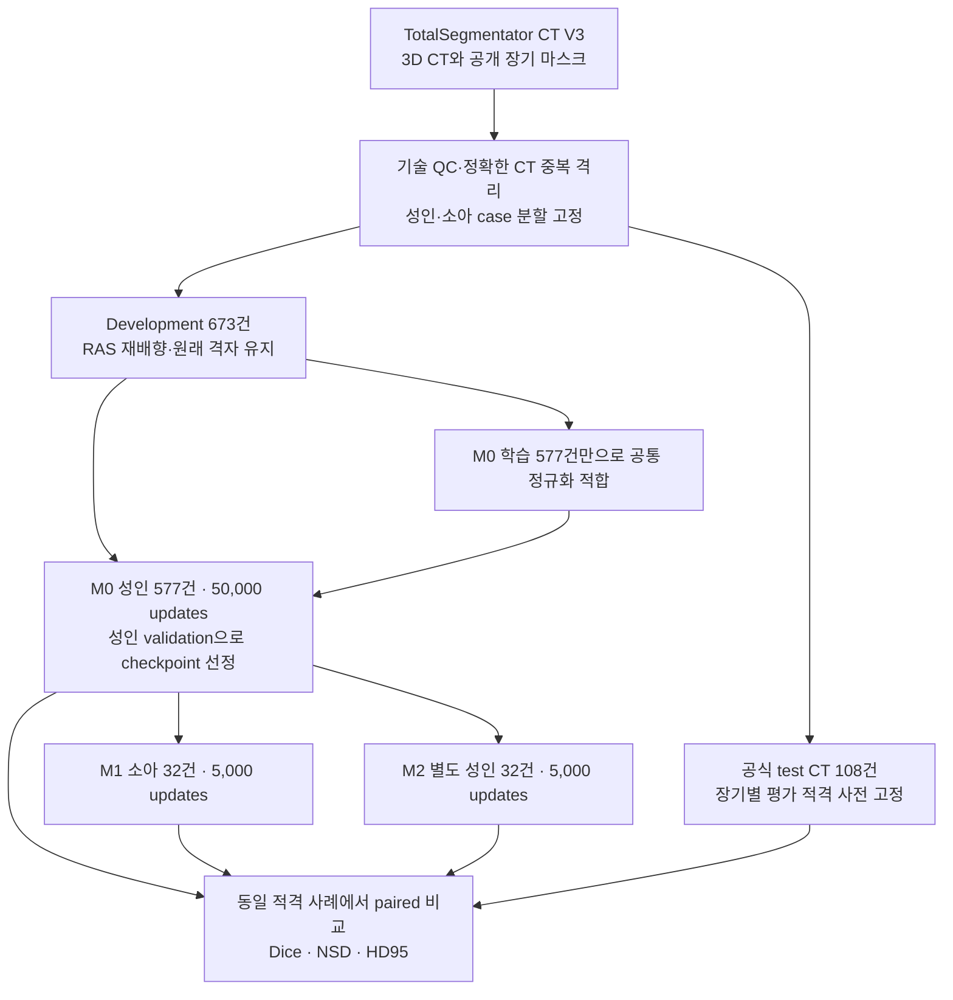

# 성인 CT 기반 복부 분할 모델의 소아 데이터 미세조정 효과에 대한 장기별 이질성 분석

*Organ-Wise Heterogeneity in the Effects of Fine-Tuning Adult-Trained Abdominal CT Segmentation Models on Pediatric Data*

성인 CT 학습 모델을 소아 CT에 적응시켰을 때 **장기별 개선량이 얼마나 다른가**를 분석하는
학부 연구 프로젝트다. TotalSegmentator CT V3 공개 데이터의 7개 복부 장기를 사용한다.
환자 ID가 제공되지 않아 **case 단위 탐색 연구**로 설계했고, 공개 reference mask의 자동 QC와
제한된 수동 검토를 거쳤다. 결정과 실행 이력은 [연구 실행 기록](docs/experiment_log.md)에 남겼다.

**최종 상태: 5개 학습 seed × 3개 모델의 학습, 공식 test 1,620회 평가 및 결과 검산 완료.**
공식 소아 test에서 M1이 동일 예산 성인 미세조정 M2보다 **10.27 Dice점** 높았다.
좌부신 **+35.93점**, 우부신 **+17.97점**, 췌장 **+10.23점**으로 이득이 집중됐다.
성인 test에서 M1은 성인 기준 M0보다 **3.45점** 낮았다. 두 macro 변화 방향은 5개 seed 모두에서 같았다.
1 Dice점은 원점수 0.01이다.

## 기말보고서 작성 자료

표지·참고문헌을 제외한 본문 8쪽을 2–2–1–2–1쪽으로 배분한다. 실제 조원·역할·제출일은 팀에서 작성한다.
아래 표는 실험 자료의 위치와 해당 절에 들어갈 내용을 연결한다.

| 보고서 절 | 본문에 가져갈 내용 | 근거 자료 |
|---|---|---|
| **1. 주제 선정배경** | 성인 학습 모델의 소아 적용 격차, 평균 Dice가 가리는 장기별 차이. 입력은 3D CT, 출력은 배경과 7개 복부 장기의 voxel 분할. 질문은 동일 추가 학습 예산에서 소아 CT 사용 효과가 장기마다 얼마나 다른가이다. | [배경·인용 자료](#배경과-참고문헌), [중간발표 대비 변경](#중간발표-대비-실험-결정) |
| **2. AI 아이디어 구체화** | 그림 1에 QC·split과 배열 전처리를 따로 표시한다. M0의 선정 가중치에서 M1·M2로 분기하고, 정규화와 학습 설정을 공통 적용한다. | [실험 구조도](#그림-1-실험-구조), [모델·학습 설정](#본-학습-설정), [전처리](#공유-전처리-기록) |
| **3. 비교군 선정** | M0은 성인 기준, M1은 소아 적응, M2는 추가 학습 자체에 대한 동일 예산 대조군. 주 비교는 소아 M1−M2. Dice는 겹침, NSD·HD95는 경계 정합성을 평가한다. | [비교군](#연구-질문과-비교군), [지표·적격 기준](#고정된-평가-규칙) |
| **4. 실험 및 결과** | 표에 분할별 건수와 공식 test의 장기별 적격 `n`을 적는다. 그림 2로 소아 이득·성인 변화, 표로 소아 절대 Dice와 경계 지표를 제시한다. 5개 seed별 값을 함께 확인한다. | [분할](#고정-데이터-배정), [공식 test 결과](#공식-test-결과), [그림 2](docs/figures/official_test_dice.png), [실험 산출물 Release](https://github.com/Laplace-tech/totalsegmentator-v3-pediatric-adaptation/releases/tag/v1.0.0-study) |
| **5. 결론** | 소아 이득의 장기별 차이 → 성인 성능 변화 → 소아 소표본·환자 연결 부재·촬영 조건 및 라벨 한계. 관측된 차이는 이 코호트의 기술적 결과로 해석한다. | [해석과 한계](#해석과-한계), [최종 검산 기록](docs/experiment_log.md) |

### 중간발표 대비 실험 결정

표 2를 작성할 때 실제 제출한 중간발표 자료에서 언급한 내용과 대조한다.

| 항목 | 초기 계획 | 최종 실험 | 결정 근거 |
|---|---|---|---|
| 데이터·비교군 | TotalSegmentator CT V3, M0·M1·M2 | 동일 설계를 유지하고 7개 복부 장기로 범위를 고정 | 전체 패널 시험과 별도로 복부 장기별 비교 범위를 확정 |
| 추가 학습량 | 군당 128건 잠정 | 소아 32건·성인 32건 | 기술 QC와 장기 적격 기준을 통과한 소아 개발 후보가 54건. 학습 32건, validation 16건, 미배정 6건 |
| 분할 | 환자 단위 계획 | case 단위 분할 및 정확한 중복 CT 격리 | 공개 배포본에서 환자 연결 ID를 확인할 수 없음 |
| 반복 | 첫 seed 후 반복 여부 판단 | 같은 split에서 독립 학습 seed 5개 | 첫 개발 결과를 확인한 뒤 공식 test 추론 전에 전체 seed를 선언하여 학습 난수에 대한 안정성 평가 |
| 거리 측정 | Dice·NSD·HD95 | 지표 유지. NSD 2 voxel, HD95 voxel 단위 | 원본 NIfTI의 물리적 공간 단위를 검증할 수 없어 index grid 사용 |

### 그림 1 실험 구조



고정 split seed는 `20261029`다. 학습 seed는 `20261029`, `20261030`, `20261031`, `20261101`, `20261102`로,
각 seed에서 M0부터 학습한 뒤 동일한 선정 M0를 M1·M2의 출발점으로 사용한다.

### 공식 test 결과

성인 88건·소아 20건에 선정 모델 15개를 적용해 **1,620개 모델–CT 조합**과 **11,340개 장기 기록**을 저장했다.
점수는 장기별 적격 사례를 먼저 평균하고, 요약 Dice에서는 7장기에 같은 가중치를 준다.
아래 수치는 slice 수, voxel 수, 전체 CT 수로 가중한 평균이 아니다.

| 학습 seed | 소아 M0 | 소아 M1 | 소아 M2 | 소아 Δ M1−M2 | 소아 Δ M1−M0 | 성인 M0 | 성인 M1 | 성인 M2 | 성인 Δ M1−M0 |
|---|---:|---:|---:|---:|---:|---:|---:|---:|---:|---:|
| 20261029 | 0.7077 | 0.8174 | 0.6940 | +12.34 | +10.97 | 0.9119 | 0.8791 | 0.9162 | −3.28 |
| 20261030 | 0.7300 | 0.8144 | 0.7234 | +9.11 | +8.44 | 0.9174 | 0.8797 | 0.9162 | −3.77 |
| 20261031 | 0.7282 | 0.8137 | 0.7181 | +9.57 | +8.55 | 0.9149 | 0.8838 | 0.9155 | −3.10 |
| 20261101 | 0.6556 | 0.8049 | 0.6909 | +11.40 | +14.93 | 0.9048 | 0.8662 | 0.9037 | −3.86 |
| 20261102 | 0.7363 | 0.8142 | 0.7248 | +8.94 | +7.79 | 0.9135 | 0.8811 | 0.9140 | −3.24 |
| **5개 seed 평균** | **0.7116** | **0.8129** | **0.7102** | **+10.27** | **+10.14** | **0.9125** | **0.8780** | **0.9131** | **−3.45** |

Δ는 Dice점이다. 5개 seed의 표본 SD는 소아 M1−M2 **1.51점**, 소아 M1−M0 **2.94점**, 성인 M1−M0 **0.34점**이다.
성인에서 M2−M0 평균은 **+0.06점**이었다. 20261101의 소아 M1−M0 차이가 가장 컸지만 M1 절대 점수는 오히려 다섯 seed 중 가장 낮았다.

| 소아 test 장기 | 주 분석 `n` | M0 Dice | M1 Dice | M2 Dice | M1−M2 Dice점 | M1−M2 NSD | M1−M2 HD95 (voxel) |
|---|---:|---:|---:|---:|---:|---:|---:|
| 간 | 7 | 0.9388 | 0.9526 | 0.9385 | +1.41 | +0.0404 | −6.42 |
| 비장 | 8 | 0.7966 | 0.8212 | 0.8021 | +1.91 | +0.0034 | +15.04 |
| 좌신장 | 6 | 0.9342 | 0.9416 | 0.9169 | +2.47 | +0.0191 | −0.86 |
| 우신장 | 6 | 0.9406 | 0.9525 | 0.9327 | +1.98 | +0.0341 | −11.28 |
| 췌장 | 7 | 0.6523 | 0.7575 | 0.6552 | +10.23 | +0.1355 | −2.66 |
| 좌부신 | 9 | 0.2205 | 0.6091 | 0.2498 | +35.93 | +0.3540 | −5.67 |
| 우부신 | 8 | 0.4980 | 0.6561 | 0.4764 | +17.97 | +0.1618 | −1.48 |

HD95 변화는 두 모델 모두 유한한 사례의 조건부 결과다. 췌장·좌우 부신의 공통 유한쌍은 각각 6건이다.
소아 주 분석에서 M2의 빈 예측 11개 중 **8개가 M1에서 유한한 HD95로 전환**했고, 반대 방향은 1개, 양쪽 모두 빈 예측은 3개였다.
빈 예측을 포함한 Dice·NSD와 유한쌍 HD95는 분모가 다를 수 있다.

| 소아 M1−M2 Dice점 | 20261029 | 20261030 | 20261031 | 20261101 | 20261102 |
|---|---:|---:|---:|---:|---:|
| 간 | +1.54 | +1.27 | +1.25 | +1.47 | +1.54 |
| 비장 | +2.05 | −0.61 | +1.76 | +5.86 | +0.49 |
| 좌신장 | +7.33 | +0.63 | +2.25 | +1.23 | +0.91 |
| 우신장 | +1.58 | +1.88 | +1.00 | +2.97 | +2.49 |
| 췌장 | +10.17 | +9.35 | +10.33 | +11.95 | +9.35 |
| 좌부신 | +45.67 | +32.04 | +36.38 | +31.17 | +34.38 |
| 우부신 | +18.04 | +19.19 | +14.00 | +25.19 | +13.45 |


그림 2. 소아 M1−M2와 성인 M1−M0의 장기별 평균 Dice점. 오차막대는 각 장기의 paired case bootstrap 95% 구간이며
seed 간 SD와 분리한다. 두 패널의 x축 범위는 다르다. 모든 성인 장기의 M1−M0 평균 Dice가 낮았고 좌부신 −7.65점, 우부신 −7.86점이 가장 컸다.

### 해석과 한계

- 주 비교에서 **양 부신이 7장기 균등평균 이득의 약 75%**를 차지했다. 양 부신과 췌장은 모든 seed에서 이득 상위 3개였다. 비장은 한 seed에서 M1이 M2보다 낮았다. 좌부신은 소아 미세조정 후에도 절대 Dice가 약 0.61이었다.
- 주 분석의 소아 M1−M2는 +10.27점이다. 경계 접촉 라벨을 포함하면 +9.77점, **7장기 모두 적격인 동일 소아 5건**만 쓰면 +10.29점이었다. 이 두 분석에서도 양 부신의 이득이 가장 컸다.
- 소아 NSD의 장기별 평균 차이는 모두 양수였다. 비장은 Dice 평균이 개선됐지만 HD95 평균이 증가했고 해당 HD95 구간은 0을 포함했다. 성인 Dice 저하가 모든 경계 지표에서 같은 양상으로 나타난 것은 아니다.
- Validation 최고점이 선정된 M0를 사용했다. `20261101`은 성인 validation 최고인 27,500 updates를 선정했고, 30,000 이후 양쪽 부신 Dice가 0이 됐다. `20261031` 우부신과 `20261102` 좌부신의 후반 급락은 이후 회복했다. 원인은 미확정이다. [학습 안정성 및 검산 기록](docs/experiment_log.md)
- 소아 주 분석은 장기별 6–9건이고, 각 seed는 같은 CT를 반복 평가한다. Case bootstrap은 seed·모델 정보를 묶어 재표집했다. 장기별 차이는 기술적 관찰이며 별도의 장기 간 가설검정 결과가 아니다.
- 기관·촬영 조건은 군 간 완전히 통제되지 않았다. 환자 ID가 없어 반복 촬영의 독립성을 보장할 수 없고, 라벨은 공개 reference의 제한적인 기술 QC 기반이다. 외부 소아 코호트 검증과 물리적 거리 측정은 별도 과제다.

### 배경과 참고문헌

참고문헌 번호는 보고서 본문에서 처음 인용하는 순서에 맞춘다.

- CT 다장기 분할과 공개 모델의 배경. [Wasserthal et al., *Radiology: Artificial Intelligence*, 2023](https://doi.org/10.1148/ryai.230024)
- 성인 학습 모델의 소아 일반화와 소아 적응 선행연구. 해당 연구는 자체 외부 코호트에서 성인 0.81·소아 0.73의 평균 Dice를 보고했다. [Chatterjee et al., *Journal of Imaging Informatics in Medicine*, 2025](https://doi.org/10.1007/s10278-024-01273-w)
- 실제 사용한 입력은 **V3.0.0**이다. 배포본은 CT 1,939개·117개 구조이며 이 가운데 7개 복부 장기를 평가 대상으로 고정했다. 원 논문은 V1의 104개 구조를 설명한다. [TotalSegmentator CT V3.0.0 · Zenodo](https://doi.org/10.5281/zenodo.22688904)
- 모델 및 학습 구성 요소의 배경. 이 실험은 명시적으로 설정한 PlainConvUNet을 사용했다. [Isensee et al., *Nature Methods*, 2021](https://doi.org/10.1038/s41592-020-01008-z)
- 경계 지표 구현. [DeepMind surface-distance](https://github.com/google-deepmind/surface-distance)

### 산출물 다운로드 및 확인

[최종 실험 GitHub Release](https://github.com/Laplace-tech/totalsegmentator-v3-pediatric-adaptation/releases/tag/v1.0.0-study)에서 파일을 받는다.

| 파일 | 포함 내용 |
|---|---|
| `tsv3-experiment-evidence.tar.gz` | `manifests/`의 감사·QC·검토·split·공식 평가 계약과 `outputs/`의 결과·SQLite·로그·5 seed 실행 스냅샷. `data/preprocessed/`의 정규화 통계와 두 cache manifest·검증 기록 포함 |
| `tsv3-checkpoints-<seed>.tar` 5개 | 보존된 **28개 checkpoint**. 15개 선정 모델, 후속 seed의 `latest.pt`, 첫 seed의 cache 이관 전 M0 체크포인트 포함 |
| `SHA256SUMS.txt` | 모든 Release 자료의 다운로드 무결성 확인용 SHA-256 |

보고서만 작성할 때는 evidence 아카이브면 충분하다. Git clone 루트에서 풀면 기존 디렉토리 구조를 그대로 사용한다.
`outputs/test_abdominal_v1/report.md`는 요약 표, `summary.json`은 **seed별·장기별 전 지표와 민감도 분석**,
`scores.sqlite`는 case별 원점수다. `summary.json`의 `seeds` 순서가 `per_seed_mean` 배열의 순서다.
가중치가 필요한 경우 해당 seed tar를 추가로 푼다. `torch.load`를 사용하는 파일은 출처와 hash를 확인한다.

```bash
sha256sum -c SHA256SUMS.txt --ignore-missing
tar -xzf tsv3-experiment-evidence.tar.gz
# 해당 가중치를 내려받은 경우
tar -xf tsv3-checkpoints-20261029.tar
```

영상 원본은 분할·정규화 자료와 분리하여 [공식 CC BY 4.0 배포본](https://doi.org/10.5281/zenodo.22688904)에서 받아
`data/raw/Totalsegmentator_dataset_v300/`에 둔다. 약 21 GiB의 fast 배열 cache는 개발 학습을 위한 파생 파일이며,
공식 test는 원본 CT와 선정 가중치를 사용한다. cache 재생성은 아래 [공유 전처리 기록](#공유-전처리-기록)과
[fast cache 변환](#m0-데이터-읽기-병목-수정-2026-10-30)을 따른다. 공개 archive를 이미 푼 경우 재생성 경로는 새 디렉토리를 사용한다.

```bash
uv sync --frozen --extra training --extra review --extra evaluation
.venv/bin/python scripts/02_summarize_development.py --seeds 20261029 20261030 20261031 20261101 20261102
.venv/bin/python -m tsv3.evaluation --preflight
# 공식 test 재현이 필요할 때 별도 출력 경로로 실행
.venv/bin/python -u -m tsv3.evaluation --official-test --output outputs/test_abdominal_v1_reproduction
# 재학습을 위한 cache 배열을 새 경로에 생성할 때만 실행
.venv/bin/python -u -m tsv3.preprocessing --output data/preprocessed/abdominal_v1_rebuilt
.venv/bin/python -u -m tsv3.fast_cache --source data/preprocessed/abdominal_v1_rebuilt --output data/preprocessed/abdominal_v1_fast_rebuilt
```

## 연구 질문과 비교군

소아 데이터의 효과를 단순한 추가 학습 효과와 분리하기 위해 같은 예산으로 세 모델을 비교한다.

| 모델 | 학습 | 역할 |
|---|---|---|
| M0 | 성인 577건에서 무작위 초기화, 50,000 updates | 성인 기반 기준선 |
| M1 | 해당 seed의 선정 M0에서 소아 32건, 5,000 updates | 소아 적응 |
| M2 | 같은 선정 M0에서 성인 32건, 5,000 updates | 동일 예산의 성인 추가 학습 대조군 |

M0는 **공식 TotalSegmentator V3 pretrained 모델이 아닌** 자체 학습 PlainConvUNet이다.
세 모델은 성인·소아 development validation 각 16건의 동일 case에서 비교한다.
공식 test 108건(성인 88, 소아 20)은 학습·선정에서 격리했다.
5개 seed의 학습과 development 분석을 마친 뒤, 선정된 15개 모델로 공식 test를 평가했다.
각 seed의 M1·M2는 동일한 선정 M0에서 출발하며, seed별 결과를 별도 환자로 세지 않는다.

## Development validation 결과

아래 값은 case별 7장기 hard Dice를 평균한 macro 값이다. 모델 선택에 반복 사용된 작은 validation의
탐색 결과이며 공식 test 성능이 아니다. M0의 소아 점수는 선정된 checkpoint를 고정한 뒤
사후에 같은 소아 validation 16건에서 측정했으며 M0 모델 선택에 사용하지 않았다.

| Seed | 소아 M0 | 소아 M1 | 소아 M2 | 성인 M0 | 성인 M1 | 성인 M2 |
|---|---:|---:|---:|---:|---:|---:|
| 20261029 | 0.705362 | 0.817575 | 0.674918 | 0.937395 | 0.905337 | 0.938348 |
| 20261030 | 0.709255 | 0.819491 | 0.700943 | 0.941428 | 0.910406 | 0.942540 |
| 20261031 | 0.702261 | 0.817228 | 0.687018 | 0.936042 | 0.904111 | 0.933513 |
| 20261101 | 0.652641 | 0.812165 | 0.671741 | 0.931004 | 0.891954 | 0.934086 |
| 20261102 | 0.712371 | 0.815344 | 0.695490 | 0.937916 | 0.905380 | 0.937646 |

| 같은 case의 macro Dice 차이 | 20261029 | 20261030 | 20261031 | 20261101 | 20261102 | 5-seed 평균 ± 표본 SD |
|---|---:|---:|---:|---:|---:|---:|
| 소아 M1−M2, 주 비교 | +0.142657 | +0.118548 | +0.130210 | +0.140424 | +0.119854 | **+0.130339 ± 0.011207** |
| 소아 M1−M0 | +0.112213 | +0.110235 | +0.114967 | +0.159524 | +0.102972 | **+0.119982 ± 0.022547** |
| 소아 M2−M0 | −0.030444 | −0.008313 | −0.015243 | +0.019100 | −0.016881 | −0.010356 ± 0.018316 |
| 성인 M1−M0 | −0.032058 | −0.031022 | −0.031931 | −0.039050 | −0.032536 | **−0.033319 ± 0.003250** |
| 성인 M2−M0 | +0.000953 | +0.001111 | −0.002528 | +0.003082 | −0.000270 | +0.000470 ± 0.002062 |

| 장기 | 소아 M1−M2 평균 ± seed SD | 소아 M1−M0 평균 | 성인 M1−M0 평균 |
|---|---:|---:|---:|
| liver | +0.032762 ± 0.006535 | +0.030624 | −0.009920 |
| spleen | +0.039230 ± 0.004468 | +0.031911 | −0.007058 |
| kidney_left | +0.060401 ± 0.052099 | +0.033478 | −0.010145 |
| kidney_right | +0.074564 ± 0.023142 | +0.036754 | −0.016269 |
| pancreas | +0.103347 ± 0.009410 | +0.118738 | −0.034043 |
| adrenal_gland_left | +0.376839 ± 0.038207 | +0.383133 | −0.067749 |
| adrenal_gland_right | +0.225226 ± 0.063635 | +0.205237 | −0.088052 |

다섯 seed 모두 소아 M1−M2와 M1−M0는 7/7장기 평균·16/16 case macro에서 양수였고,
성인 M1−M0는 각 seed의 16/16 case macro에서 음수였다. 성인 장기 평균은
20261101의 비장만 소폭 상승했고 나머지는 감소했다. 양 부신이 소아 M1−M0의
7장기 균등평균 이득 합계 중 약 70%를 차지한다. 왼쪽 신장의 M1−M2는 seed별
+0.027679~+0.152806으로 크기 변동이 크며 첫 seed M2의 성능 하락이 영향을 주었다.
이 패턴은 **development 관찰**이다. [공식 test 결과](#공식-test-결과)는 별도 집계다.

이전 3-seed 시점의 그림은 [중간 집계 그림](docs/figures/development_validation.png)으로 보존한다.
최신 수치는 위 5-seed 표를 따른다.

같은 16 case의 세 모델·다섯 seed 값을 묶어 재표집한 10,000회 탐색적 paired case bootstrap
95% percentile 범위는 소아 M1−M2 [+0.105610,+0.156517], 소아 M1−M0
[+0.099393,+0.140939], 성인 M1−M0 [−0.042548,−0.025010]이다. 모델 선정에
사용된 작은 validation에 조건부인 범위이며 확인적 유의성 검정이나 일반화 보장은 아니다.
Seed 다섯 번의 결과는 동일 cohort 16 case를 반복 평가한 값이다.

다섯 seed의 split·정규화·모델·loss·학습 numeric config는 seed 값 외 동일하다.
첫 seed 실행 중 무손실 fast cache로 이관했고 이후 seed는 fast cache와 CPU prefetch를
사용했다. 둘째·셋째 seed의 `training.py` 파일 hash는 달라도 AST는 같으며, 셋째 실행의
`study.json`에는 test 평가 전 5-seed 계획 개정이 포함됐다. 실행 코드까지 bitwise 동일했다고
주장하지 않는다. [집계 실행 파일](scripts/02_summarize_development.py)은 로컬의 seed별
validation 파일을 검산하고 paired 결과를 생성한다.

```bash
.venv/bin/python scripts/02_summarize_development.py --seeds 20261029 20261030 20261031 20261101 20261102
```

결과 JSON은 `outputs/training_abdominal_v1_seed20261102/replication_validation.json`에
보관한다. 실험 원점수와 checkpoint는 [Release 아카이브](#산출물-다운로드-및-확인)에서 받을 수 있다.

학습 안정성 이력도 보존한다. 20261031 M0의 우부신 Dice는 32,500~42,500 updates에서
0으로 떨어졌다가 회복했다. 20261101 M0는 30,000 이후 양 부신 Dice가 0으로 떨어져
끝까지 회복하지 않았으나, 성인 validation 최고인 27,500 checkpoint를 규칙대로 선정해
M1·M2가 출발했다. 원인은 미확정이다. 이 seed의 낮은 소아 M0 점수가 큰 M1−M0 차이에
영향을 주었으므로 적응 효과의 강화로 단정하지 않는다. 20261102는 VS Code 종료 후
M1 update 1,750 checkpoint에서 재개했고 모든 branch를 완료했다.

## 연구 로드맵 — 2026-11-26 완료 상태

| 단계 | 상태 | 산출물·완료 조건 |
|---|---|---|
| 1. 연구 설계·평가 규칙 | 완료 | 7장기, M0/M1/M2, 동일 추가 학습 예산, 고정 평가 계약 |
| 2. 데이터 감사·QC·split | 완료 | 중복 CT train 측 격리, case 단위 분할·포함 제외 기록 |
| 3. 환경·전처리·실행 검증 | 완료 | M0 전용 정규화, 공유 fast cache 673건, 재개·무결성 검사 |
| 4. 5-seed 학습 | 완료 | 15개 모델, seed마다 M0 50,000·M1/M2 각 5,000 updates |
| 5. Development 결과 집계 | 완료 | 각 seed 선정 M0 소아 평가, paired Dice·장기별 변화·seed SD·case bootstrap |
| 6. 공식 test 실행 경로 구현·통합 검증 | 완료 | 원래 CT grid 복원, 장기 mask 점수 계산, SQLite 재개, development GPU smoke |
| 7. 공식 test 평가 | 완료 | 15개 selected 모델 × 성인 88·소아 20건, 총 1,620회 |
| 8. Test 집계·이질성 분석 | 완료 | 장기별 M1−M2/M1−M0, 성인 변화, seed 평균·SD·case bootstrap, HD95 실패 전이·민감도 분석 |
| 9. 결과 보존·팀 인수인계 | 완료 | 코드·설정·결과·검산·그림 및 실행 산출물 공개 |
| 10. 기말보고서 작성·제출 | 팀 작성 | 제출 양식에 맞춰 각 절과 표·그림을 배치하고 분량·인용 확인 |

실행기는 기존 평가 계약과 선정 checkpoint를 검증하고, 원본 grid로 복원한 prediction을
개별 장기 mask와 비교한다. 모델–case별 SQLite 저장이 끝난 작업은 재실행 시 건너뛴다.
장기 부피·초기 성능과 개선량의 관계는 사전 기록된 탐색 분석으로 다루며 인과 설명으로
해석하지 않는다. Test 결과를 보고 seed·모델·학습 예산·평가 규칙을 다시 고르지 않는다.

## 완료 결과 재검산

Fast cache 673건의 검증과 원본 전처리 배열 약 25.55 GiB 정리를 완료했다.
5개 seed의 M0→M1→M2 학습과 development 집계를 완료했다.

| Seed | 상태 |
|---:|---|
| 20261029, 20261030, 20261031, 20261101, 20261102 | 학습·M0 소아 사후 평가·5-seed 집계 완료 |
| 공식 test 평가 | 1,620회 평가·결과 검산 완료 |

```bash
.venv/bin/python scripts/02_summarize_development.py --seeds 20261029 20261030 20261031 20261101 20261102
```

위 명령은 완료된 결과를 다시 검산하는 명령이다. 5개 triplet 모두의 update 예산·동일 M0
출발·checkpoint 검증을 완료했고 각 seed의 장기별 paired 차이와 전체 평균·표본 SD·
방향 일치 횟수를 집계했다. 공식 test는 모든 seed의 학습이
끝난 뒤 고정 평가 계약으로 한 번 평가하며, test 결과로 seed를 고르거나 설정을 조정하지 않는다.
동일 case의 여러 seed 결과를 독립 환자로 세지 않고, case bootstrap에서는 seed·모델 값을
case와 함께 묶어 재표집한다. 반복 seed는 같은 split의 학습 난수 변동을 보여주며,
소아 test의 장기별 적격 사례 6–9건과 환자 ID 부재라는 한계는 그대로 남는다.
원본 CT는 공식 배포본으로 연결한다. 가중치·case별 manifest·실행 출력은 Release에 보존한다.
Git 트리에는 검증된 집계값, 방법, 그림과 실행 코드를 둔다.

## 실행 환경

WSL/Linux, Python 3.12를 사용한다. 전체 의존성은 `uv.lock`에 고정했다.

```bash
uv sync --frozen                  # 데이터 감사만 실행할 환경
uv sync --frozen --extra training # CUDA 12.6 PyTorch와 nnU-Net 구성 요소 포함
uv sync --frozen --extra training --extra review # 학습 구성 요소와 검토 이미지 생성
uv sync --frozen --extra training --extra review --extra evaluation # 고정 평가 구현까지 포함
```

GPU·Windows의 실제 여유 공간을 확인한 뒤 설치한다. WSL 내부 `df`의 여유 용량만으로
가상디스크가 위치한 Windows 드라이브의 여유 공간을 판단하지 않는다.

## 고정 데이터 배정

현재 연구 설정은 `configs/study.json`, 고정된 case 배정은
`manifests/splits_abdominal_v1/splits.json`이다. `assignments.csv`는 조회용 export이며,
case별 제외 이유를 함께 기록한다. 생성된 split을 손으로 수정하거나 같은 경로에 덮어쓰지 않는다.

| 역할 | case 수 |
|---|---:|
| M0 성인 학습 | 577 |
| M1 소아 fine-tuning | 32 |
| M2 성인 fine-tuning | 32 |
| 성인 validation | 16 |
| 소아 validation | 16 |
| 미사용 소아 development | 6 |
| 공식 성인 test 중 기술 QC 통과 | 88 |
| 공식 소아 test 중 기술 QC 통과 | 20 |

### 전체 1,939건의 배정·미사용 이유

아래 행은 **서로 겹치지 않는 최종 행선지**이며 합계가 1,939건이다. `excluded` 1,152건은
QC 단계 제외 28건과 개발셋의 7장기 기준 미충족 1,124건의 합계이지, 1,152건 모두가
CT 또는 라벨 오류로 판정된 것은 아니다.

| 최종 행선지 | 건수 | 근거 |
|---|---:|---|
| QC 단계 제외 | 28 | 연령 결측 15, 100세 초과 출처 확인 필요 3, 중복 CT 격리 4, 기술 오류 6 |
| 공식 test 보존 | 108 | 성인 88, 소아 20. 개발셋의 7장기 동시 적격 기준을 적용하지 않음 |
| 개발 후보에서 7장기 중 하나 이상 빈 mask | 866 | 자동 QC 통과 train 중 7장기 전부 nonempty 조건 불충족 |
| 7장기 모두 nonempty이나 하나 이상 경계 접촉 | 258 | 자동 QC 통과 train 중 no-border 조건 불충족 |
| 개발 학습·validation 배정 | 673 | M0 577, M1 32, M2 32, 성인·소아 validation 각 16 |
| 적격 소아 development 미배정 | 6 | 소아 적격 54건에서 M1 32·validation 16건 배정 후 남음 |

자동 QC 통과 train 1,803건 중 866건에는 선택한 7장기의 빈 mask가 하나 이상 있으며,
이 가운데 584건은 7장기 mask가 전부 비어 있다. 이는 이 연구의 개발셋 기준 미충족이지
영상 자체가 불량하다는 판정이 아니다. 경계 접촉 258건도 장기 부분 촬영을 확정한 수가 아닌
보수적 screen 결과다. 이 기준은 성인 적격 625건, 소아 적격 54건을 남기며 선택 편향을 만든다.
소아 미배정 6건은 같은 자동 기준을 통과했지만 전문가 전체 영상 검수가 완료됐다는 뜻은 아니다.
`s1152`는 1,152건이라는 수와 별개인 **성인 공식 test case**다.

Test 88·20건은 보존된 pool의 크기다. 모델 예측을 생성하기 전에 고정한 장기별 평가 표본 수는 아래 평가 규칙에 정리했다.

2026-10-29 사용자 확인에 따라 **공개 reference mask + 기술 QC + 기록된 수동 보류 제외**를
학습·validation 라벨 사용 기준으로 채택했다. 이전의 전체 영상 검수 완료를 필수로 하던
계획을 명시적으로 수정했다. 수동 ledger의 `pending`·`uncertain`을 `acceptable`로 바꾸지 않았고,
전문가 전체 volume 검수 또는 임상적 annotation 정확성을 주장하지 않는다.

Development에는 7개 장기가 모두 nonempty이고 image 경계 flag가 없는 case만 포함한다.
기록된 annotation reject, partial/out-of-FOV/true-absence 판정도 제외한다.
이 screen은 annotation 오류를 모두 제거하거나 장기의 완전한 FOV를 보장하지 않는다.
선정된 cohort에 대한 탐색 연구이며, 모든 소아 CT로 일반화하는 데 선택 편향이 남는다.

Seed 20261029로 정렬된 case 목록을 cohort별로 균등 무작위 추출한다.
성인은 validation → M2 → 나머지 M0, 소아는 validation → M1 → 나머지 미사용으로 배정한다.
M2는 M0에서 미리 제외하며 모든 역할은 case·정확한 CT content hash 기준으로 중복되지 않는다.
기관·촬영 조건 matching은 하지 않았다. 역할별 age·기관·촬영 metadata 분포를 split JSON에 기록했다.

환자 ID가 없으므로 **case 단위 분할**을 사용한다. 동일 CT의 정확한 중복은 제외했지만,
동일 환자의 다른 촬영·재표본화 영상까지 모두 확인한 것은 아니다. 통계 재표집도 case 단위이며,
미확인 환자 중복이 신뢰구간을 좁게 만들 수 있다. 관측한 개선은 해당 소아 cohort에 대한 적응 효과로
해석하고 연령·해부학 차이만의 인과 효과로 주장하지 않는다.

## 실제 데이터 실행 시험: 통과

`outputs/feasibility_abdominal_v1/result.json`과 `run.log`에 결과를 보존한다.
Development 8건, 7개 장기 + background, patch 96×128×128, batch 1로 실행했다.

- 세 분기 각 7회 optimizer update, AMP skip 0, finite loss.
- M1·M2 시작 가중치 hash 동일.
- 두 development validation 영상에 대한 세 모델의 전체 영상 추론·원래 크기 복원 정상.
- 8건 모두 전처리 후 7개 라벨 유지. 겹친 mask voxel은 loss에서 ignore 처리.
- 최대 GPU allocated 1,842.8 MiB, reserved 2,548 MiB, process RSS 7,170.0 MiB.
- 전체 약 119초. 가중치·예측·전처리 배열은 저장하지 않았다.

이는 실행 가능성 증거이며 본 학습의 정확도 결과가 아니다. 모든 case의 자원 사용을 보장하지 않는다.
검증된 patch·batch·명시적 PlainConvUNet 구조를 `training.fixed_execution_plan`에 기록했다.
저장 격자를 canonical RAS로 재배향하고 추가 downsampling은 하지 않는다.
Stored spacing은 nominal 1.5이지만 header의 물리 단위는 unknown이다. 2026-10-30 사용자 결정으로
HD95는 voxel 단위, NSD는 2 voxel 허용 거리로 계산하고 mm로 환산하지 않는다. 자동 planning된 nnU-Net benchmark 재현은 아니다.

673건 cache·label 보존·M0 577건 전용 정규화와 전체 validation 실행 시험을 검증했다.
수치 학습 계획, 거리 지표의 정의·단위, test 장기별 eligibility를 고정했다.
`study.status`는 `ready_for_research_training`이며 실제 학습 시작 전 smoke 근거와 평가 manifest의 hash를 검사한다.
짧은 probe나 smoke 가중치를 연구용 M0로 이어서 사용하지 않는다.
메모리는 전체 cohort를 RAM에 올리지 않고 case별 전처리와 공유 disk cache로 제한한다.
긴 전처리·학습은 사용자에게 터미널 명령으로 전달한다.

## 공유 전처리 기록

공유 구현은 `src/tsv3/preprocessing.py` 하나다. 기존 probe도 같은 전처리·정규화 함수를 사용한다.
학습용 641건과 validation 32건, 총 **673건**만 처리하며 공식 test와 미사용 소아 6건은 포함하지 않는다.

모든 case의 CT float32·합친 mask uint8을 비압축 저장하면 계산상 약 **100.30 GiB**다.
이는 실제 추가 사용량이 아니라 비압축 배열의 합계다. 이번 cache는 `.npz`의 무손실 압축을 사용하고,
float16으로 값을 줄이지 않는다. 원본 `data/raw/`는 수정하지 않는다.

2026-10-29 23:48 KST 야간 검증까지 완료했다. **673/673건**, 압축 NPZ 합계 **25.55 GiB**다.
전체 원본·cache hash 재검증, 역할별 membership, 7개 label 보존, 정규화 출처 검사가 통과했다.
2026-10-30 확인한 C 드라이브 여유는 49.13 GiB다. 이 용량은 확인 시점 값이다.

아래는 중단된 전처리를 재개할 때 쓰는 명령이다. 현재 완료 상태에서 다시 실행할 필요는 없다.

```bash
.venv/bin/python -u -m tsv3.preprocessing --resume --host-volume /mnt/c
```

- `data/preprocessed/abdominal_v1/` 안에 case별 NPZ, `manifest.json`, `run.log`, 최종 `normalization.json`을 둔다.
- CT와 합친 target은 세 모델이 공유한다. 정규화된 복사본을 추가 저장하지 않고 사용할 때 같은 통계를 적용한다.
- M0 학습 577건의 selected-organ foreground에서만 case당 최대 100,000 voxel을 추출해 공통 통계를 계산한다.
- M1·M2·두 validation군에서는 정규화 학습 표본을 저장하지 않는다. 전체 cache 완료 전에는 최종 통계를 만들지 않는다.
- canonical RAS로 재배향하고 추가 downsampling을 하지 않는다. CT content hash, 선택 mask의 geometry·binary·voxel count를 확인한다.
- 겹친 mask voxel은 ignore ID 8로 기록한다. 7개 label 중 하나라도 target에서 사라지면 중단한다.
- 한 case씩 처리하고 원자적으로 저장한다. 중단 뒤 같은 명령으로 재개하며, 완료 파일과 원본의 hash를 검사한다.
- Linux 저장 공간과 `/mnt/c` 여유 공간을 모두 검사한다. 다음 case를 위한 보수적 공간과 10 GiB 여유가 없으면 중단한다.
- `/mnt/c`는 이 환경의 WSL 디스크를 보관하는 Windows volume 기준이다. 다른 PC에서는 해당 volume 경로로 바꾼다.

완료 시 `development_cache_complete_not_training_results`가 출력된다. 아직 모델 학습이나 평가 완료를 뜻하지 않는다.
공간 부족·라벨 소실·입력 변경으로 중단되면 로그의 원인을 해결해야 하며 case를 조용히 건너뛰지 않는다.
Manifest의 입력·처리 signature가 달라진 cache를 섞지 않는다. 학습률 같은 전처리와 무관한 설정 변경은
cache signature를 바꾸지 않는다. 불완전한 임시 파일은 해당 case의 재개 시 정리한다.

새 환경에서 cache가 전혀 없다면 첫 실행에는 `--resume`을 빼고 실행한다.
계획만 확인할 때는 `--dry-run`, 소량 검사에는 `--limit 2`를 쓴다. `--limit`은 추가 처리 건수다.
정상 완료한 full QC를 다시 실행할 필요는 없다. Audit의 CT hash·geometry 계산을 공유 함수로 옮겼으므로
과거 audit의 코드 signature와는 다르지만, 기존 산출물과 CT identity의 일치 여부는 전처리에서 검사한다.

## 야간 자동 실행

`tsv3.night`는 **전처리 완료 대기/중단 후 재개 → 전체 cache·원본 hash 검사 →
실제 cache 기반 GPU 통합 시험**을 순서대로 실행한다. 이 작업은 mechanical probe 설정을 사용하며
연구용 M0·M1·M2를 학습하지 않는다.

- 기존 전처리의 lock이 해제될 때까지 기다린다. 터미널 종료 등으로 중단되면 같은 cache에서 재개한다.
- 전처리가 데이터 오류로 실패한 경우 자동 재시도하거나 다음 단계로 넘어가지 않는다.
- M0 577건으로만 계산한 정규화와 673건의 역할·라벨 보존을 확인한다.
- 고정 split에서 역할별 중간 크기 development case 1건씩, 총 5건을 골라 사용한다. Test는 포함하지 않는다.
- 모델·optimizer·AMP·RNG를 저장하고, 다음 patch의 정확한 복원과 update의 수치 일치를 검사한다. CUDA NLL reduction의 비결정성 때문에 가중치·loss 비교에는 rtol=1e-5, atol=1e-6을 사용하며 실제 차이도 기록한다.
- 짧은 M1·M2 분기는 같은 M0 상태에서 시작해 동일한 update 수를 수행한다. 전체 영상 추론도 검사한다.
- 측정 JSON·로그만 보존하고 시험용 checkpoint는 임시 디렉토리에서 삭제한다.
- `status.json`이 `complete_preprocessing_and_integration_only`이면 야간 검사 성공이며 본 학습 완료를 뜻하지 않는다.

2026-10-29 작업은 완료됐다. `outputs/overnight_abdominal_v1/`의 `status.json`, `result.json`,
`run.log`가 근거다. GPU 통합 시험은 약 50.6초, process peak RSS 3,946 MiB였고,
재개 후 다음 patch·가중치·loss가 이 시험에서 일치했다. 23:54 KST Windows 종료 명령이 exit code 0을 반환한 기록도 확인했다.
이는 종료 명령의 성공 기록이며 물리적 전원 차단 자체를 OS 외부에서 측정한 결과는 아니다.
당시 tmux·Windows 종료 도우미는 일회성이며, 이후 학습 명령에 자동 종료가 따라붙지 않는다.
실행 중인 야간 작업의 코드·설정을 변경하면 중단하도록 hash를 기록한다.

```bash
# 진행 상태 확인
cat outputs/overnight_abdominal_v1/status.json
tail -n 30 outputs/overnight_abdominal_v1/run.log
```

이후 같은 검사를 새 출력 경로에서 수동으로 실행할 때 사용하는 명령:

```bash
.venv/bin/python -u -m tsv3.night --host-volume /mnt/c --output outputs/overnight_abdominal_repeat
```

Windows 절전 방지는 이번 예약 시 임시 process의 `SetThreadExecutionState` 요청으로 설정한다.
자동 작업 종료 시 release marker로 해제하고, 최대 14시간 후에도 해제한다. 영구 전원 설정을 바꾸지 않는다.
화면은 꺼져도 되지만 사용자가 직접 절전·종료·WSL shutdown을 실행하면 작업은 지속되지 않는다.

이번 야간 실행에는 별도 Windows 감시 process로 **정상 완료 후 PC 종료**도 연결했다.
`shutdown.json`에 감시 상태를 기록하며, 현재 run PID·673건 cache 검증·577건 정규화·통합 시험 성공을
확인한 뒤 5분간 취소 대기한다. 이후 `sync` → `wsl --shutdown` → `shutdown.exe /s /f /t 0` 순서로 실행한다.
실패·중단·상태 불일치에는 PC를 종료하지 않는다. 사용자의 확실한 PC 종료 요청에 따라 앱 강제 종료 옵션을 포함한다. 미저장 문서는 종료 전에 저장해야 한다.
작업 대기 중이나 5분 유예 중 취소하려면 다음 명령을 실행한다.

```bash
touch outputs/overnight_abdominal_v1/cancel_shutdown
```

감시 source와 process 정보는 이번 실행의 `launch.json`에 기록했다. 연구 코드와 전처리 signature는 변경하지 않았다.

## 검토 기록과 재현

`manifests/review_v300/review.csv`가 유일한 수동 case×장기 판정표다.
소아 133건·성인 1,086건의 검토 이미지는 생성됐으나 전체 육안 검토를 완료했다는 뜻은 아니다.
`outputs/review_v300/index.html`은 기존 PNG를 연결하며 이미지를 복제하지 않는다.
작은 mask는 검토 순서에만 사용하고 voxel 수만으로 자동 제외하지 않는다.

```bash
.venv/bin/python -m tsv3.review status
.venv/bin/python -m tsv3.splits --assess
```

`--assess`의 자동 screen 상한은 비교용 보고서다. 현재 실제 배정은 고정된 split JSON을 따른다.
BBox 중심 세 직교 단면은 제한된 검토 자료이고 전체 영상의 annotation 검증을 대신하지 않는다.
Test 이미지는 development 검토 갤러리에 포함되지 않는다.
수동 판정 변경으로 frozen split의 eligibility가 달라지면 학습 전 새 버전으로 명시적으로 재고정한다.

새 경로에서 동일 규칙으로 split을 재현할 때만 아래 명령을 사용한다. 이미 완료된 배정은 재실행할 필요 없다.

```bash
.venv/bin/python -m tsv3.splits --freeze-development --output manifests/splits_abdominal_reproduction
```

실행 시험도 이미 완료됐다. 다시 필요한 경우에만 새 출력 경로를 지정한다.

```bash
.venv/bin/python -u -m tsv3.probe --study configs/study.json --output outputs/feasibility_abdominal_repeat
```

`protocol.json`, `probe.json`, `manifests/splits_v300/`는 과거 전체 QC·128건 임시 배정·117-class
시험의 출처로 보존한다. 본 연구의 K=32 배정과 혼용하지 않는다.

## 기존 감사·시험 재현

기존 `scripts/01_audit_dataset.py`가 생성한 `manifests/audit_v300/`를 재사용한다.
새 감사 코드가 raw case 디렉토리를 다시 열거하지 않는다.

```bash
.venv/bin/python -m tsv3.audit --workers 4
# 같은 코드·설정·입력으로 중단된 감사를 재개할 때:
.venv/bin/python -m tsv3.audit --workers 4 --resume

.venv/bin/python -m tsv3.splits --provisional
.venv/bin/python -m tsv3.probe
.venv/bin/python -m unittest discover -s tests -v
```

위 split·probe는 과거 임시 설정을 재현하는 명령이다. 현재 새 연구 설정에는 사용하지 않는다.
장기 검토 manifest를 새 버전으로 생성할 때는 `python -m tsv3.review prepare --output 새경로`를 사용한다.
검토 이미지 명령에도 해당 `--review 새경로`와 별도 `--output 새경로`를 지정한다.

입력 경로는 `--raw`, `--inventory`, `--protocol`로 지정할 수 있다. 설정·입력 또는 코드가
바뀌면 새 출력 디렉토리를 사용한다. 완료된 split과 probe 출력은 덮어쓰지 않는다.

## 본 학습 설정

`configs/study.json`의 `training.numeric_training_plan`을 단일 설정 원본으로 사용한다.
2026-10-30 첫 seed의 예산을 M0 **50,000**, M1·M2 **각 5,000 optimizer updates**로 정했다.
이는 자원을 고려해 사전 선언한 탐색 예산이며 수렴이나 양의 적응 이득을 보장하지 않는다.

| 항목 | 설정 |
|---|---|
| 구조·입력 | PlainConvUNet, 7 organs + background, patch 96×128×128, batch 1 |
| optimizer | SGD Nesterov, momentum 0.99, weight decay 3e-5 |
| LR | M0 0.01; M1·M2 0.001; `LR = initial × (1 − completed_updates / budget)^0.9` |
| loss·AMP | 전경 soft Dice와 CE의 가중치 1:1. CE는 배경 포함, 겹침 ignore는 두 항에서 제외. FP16, 초기 scale 1024, gradient clip 12 |
| case sampling | 매 update 해당 학습군에서 균등 복원 추출; cache hit 여부와 무관 |
| foreground | 확률 1/3로 장기를 균등 선택한 뒤 저장된 해당 장기 좌표에서 추출 |
| augmentation | 정규화 후 brightness ×U(0.85,1.15), p=0.15; mean 중심 contrast ×U(0.85,1.15), p=0.15; Gaussian noise σ∼U(0,0.1), p=0.1; 순서 고정 |
| geometry augmentation | 사용하지 않음. 좌우 뒤집기·rotation·scale·elastic 없음 |
| validation | M0 2,500 updates마다 성인 16건; M1·M2 1,000마다 성인·소아 각 16건 |
| checkpoint 선택 | M0 성인 validation macro Dice 최대, 동률이면 먼저 나온 것; M1·M2 고정 예산 마지막 |
| 재개·보관 | 250 updates마다 원자적 latest 저장; branch별 latest/selected만 보존; optimizer·AMP·RNG·진행 상태 포함 |
| 자원 | 압축 cache 공유, RAM LRU 2 GiB + 현재 처리·추론 배열, CPU 4 threads, disk 여유 10 GiB 유지 |

Optimizer와 polynomial LR은 [nnU-Net의 구현](https://github.com/MIC-DKFZ/nnUNet/blob/master/nnunetv2/training/nnUNetTrainer/nnUNetTrainer.py)을 참고했다.
이 프로젝트의 예산·fine-tuning LR·intensity-only augmentation은 별도의 사전 선택이며 nnU-Net 전체 recipe 재현이 아니다.
강한 공간 증강을 사용하지 않는 제한, 작은 학습 예산의 underfitting 가능성은 결과에서 공개한다.
M1·M2는 같은 M0 selected checkpoint의 파일·가중치 hash를 기록하고 optimizer를 새로 만든다.
AMP skip은 성공 update로 세지 않으며 연속 10회/총 100회면 오류로 중단한다.
Validation Dice는 겹침 ignore voxel을 제외한 hard Dice다. GT가 있는 장기의 빈 prediction은 0이며,
case별 점수 → 장기별 평균 → 7장기 macro 순서로 집계한다. 공식 test는 별도 실행 경로에서 원본 개별 mask를 평가한다.

**실제 실행 경로 시험은 완료했다.** 각 branch 32 updates, 16회에서 checkpoint 복원,
각 branch의 성인·소아 validation 전체 32건 추론을 수행했다. 모든 branch에서 AMP skip 0, 정상 완료다.
시험 loss·Dice는 연구 결과나 설정 선택에 사용하지 않는다. 본 학습은 새 random M0에서 시작한다.

| 측정 | M0 시험 | M1 시험 | M2 시험 |
|---|---:|---:|---:|
| 로딩 포함 평균 seconds/update | 0.693 | 0.420 | 0.451 |
| validation 32건 전체 처리 | 310.4초 | 311.9초 | 308.7초 |
| branch 총 소요 | 335.2초 | 327.9초 | 325.7초 |

전체 약 16.5분, process peak RSS 8,481 MiB였다. 본 학습 예산에 대한 단순 외삽은 약 13시간이다.
32회 update 표본의 추정이므로 cache hit, 큰 case 추출, I/O, GPU 부하에 따라 달라진다.
시험 명령은 기록용이며 완료 상태에서 다시 실행하지 않는다.

```bash
.venv/bin/python -u -m tsv3.training --smoke --host-volume /mnt/c
```

정상 종료 문구는 `execution_smoke_passed_not_research_training`이다.
결과는 `outputs/training_smoke_abdominal_v1/`의 `run.json`, `run.log`, `M0/`, `M1/`, `M2/` 아래 JSON에만 남긴다.
시험용 checkpoint는 실행 중 임시 디렉토리에 두고 성공·실패 종료 때 정리한다.
Ctrl+C 후 smoke 재실행에는 `--resume`을 붙이되 시험용 가중치를 폐기하므로 32회 시험을 처음부터 반복한다.
본 학습의 `--resume`은 마지막 저장 update부터 재개한다. 설정·source·split·cache identity가 다르면 재개를 거부한다.
완료된 실행을 같은 명령으로 `--resume`하면 학습을 반복하지 않는다.

이 시험에는 자동 PC 종료를 연결하지 않았다. Test 108건은 읽거나 추론하지 않는다.
첫 seed의 **과거 최초 실행 명령**은 아래와 같다. 현재 반복 실행에는 사용하지 않는다.

```bash
.venv/bin/python -u -m tsv3.training --host-volume /mnt/c
```

M0 50,000 updates → 같은 selected M0에서 M1 5,000 → M2 5,000을 차례로 수행한다.
출력은 `outputs/training_abdominal_v1_seed20261029/` 한곳에 두며 branch별 `latest.pt`, `selected.pt`,
`status.json`, validation JSON과 공통 `run.json`, `run.log`, `source_snapshot.tar.gz`를 보존한다.
Source snapshot에는 실제 실행 코드·tests·configs·docs·README·pyproject·uv.lock만 넣는다.
첫 seed 실행 당시의 미커밋 변경도 snapshot에 보존했다. 현재 Git 커밋만으로 과거 실행을
bitwise 재현할 수 있다고 주장하지 않는다.
이 명령은 자동 PC 종료를 수행하지 않는다.

첫 seed 중단 후에는 같은 명령에 `--resume`을 붙여 복구했다. 코드·설정·입력이 바뀌면 재개를 거부한다.
학습 중에는 source나 설정을 수정하지 않는다. 첫 seed 상태 조회 예시는 다음과 같다.

```bash
tail -n 5 outputs/training_abdominal_v1_seed20261029/run.log
```

### M0 데이터 읽기 병목 수정 (2026-10-30)

M0를 중단했을 때 마지막 저장 checkpoint는 1,250 updates였다. 매 update에서 큰 DEFLATE NPZ를
동기적으로 읽어 GPU 대기가 길었다. 원본 cache와 정규화 통계는 그대로 두고,
`data/preprocessed/abdominal_v1_fast/`에 동일한 `data`·`seg`·`foreground_locations`를
lossless Blosc2 ZSTD level 1 + shuffle로 재포장한다. 원본 NPZ 673건 각각의 SHA256을
확인하고, 변환 직후 배열의 dtype·shape·값이 정확히 같은지 확인한다. 중단 후 재개 가능하며
변환된 파일의 hash와 원본 hash는 별도 manifest에 기록한다. `blosc2`는 고정 `uv.lock`에
포함된 설치 버전을 사용하고, fast manifest에도 버전을 기록한다.

전체 변환과 **첫 재개** 명령:

```bash
.venv/bin/python -u -m tsv3.fast_cache --resume --host-volume /mnt/c && .venv/bin/python -u -m tsv3.training --resume --fast-cache data/preprocessed/abdominal_v1_fast --upgrade-fast-cache --host-volume /mnt/c
```

변환은 Windows host volume 여유 10 GiB를 보전하며, 오류나 Ctrl+C 뒤에도 같은 변환 명령으로
이어간다. 학습 재개 직전에는 원래 checkpoint의 다음 case·patch·augmentation 입력을 두 cache에서
각각 재현하여 텐서와 RNG가 정확히 같은지 확인한다. 모델·loss·sampling·augmentation·LR 함수가
기존 source snapshot과 동일한지도 AST로 확인한다. 이 검사를 통과해야 기존 M0 checkpoint를
새 cache로 재개한다. 이 확인은 다음 한 update의 입력과 고정 함수에 대한 것이며,
전체 학습 경로의 bitwise 동일성을 주장하지 않는다.

최초 이관의 원본은 `run_before_fast_cache_upgrade.json`, `M0/pre_fast_cache_upgrade.pt`,
`source_snapshot.tar.gz`에 보존한다. 변경된 코드는 `source_snapshot_fast.tar.gz`,
검사 결과는 `run.json.cache_upgrade`에 기록한다. 이후 Ctrl+C로 다시 중단했다면:

```bash
.venv/bin/python -u -m tsv3.training --resume --fast-cache data/preprocessed/abdominal_v1_fast --host-volume /mnt/c
```

GPU utilization 향상과 실제 종료시간은 재개 후 로그 및 GPU 측정으로 확인해야 한다.

## 고정된 평가 규칙

`manifests/evaluation_abdominal_v1/contract.json`과 `eligibility.csv`에 108 test case × 7장기,
756개 조합의 포함 여부와 이유를 기록했다. 원본 CT·선정 mask 864개 파일 hash도 보존했다.
공개 reference + 자동 QC라는 기존 라벨 정책을 test에도 적용한다. 이전의 전체 FOV 수동 검수를 요구하던
미완성 기준은 명시적으로 변경했으며, 전문가 검수나 no-border = full FOV라고 주장하지 않는다.

| 장기 | 성인 주 분석 | 소아 주 분석 | 소아 민감도 분석 |
|---|---:|---:|---:|
| liver | 52 | 7 | 13 |
| spleen | 55 | 8 | 13 |
| kidney_left | 53 | 6 | 11 |
| kidney_right | 54 | 6 | 9 |
| pancreas | 52 | 7 | 12 |
| adrenal_gland_left | 55 | 9 | 11 |
| adrenal_gland_right | 57 | 8 | 12 |

주 분석은 기술 QC 통과·nonempty·no-border인 공개 mask만 사용한다. 민감도 분석은 경계 접촉이 있는
nonempty mask도 포함한다. 원인이 불명인 empty GT는 평가에서 제외하고 누락 건수와 예측 voxel 수를 별도로 보고한다.
7장기가 모두 주 분석 대상인 같은 case들(성인 49, 소아 5)의 결과도 기술적으로 함께 확인한다.
장기마다 case 구성이 다르고 소아 n=6–9이므로 장기별 차이가 해부학만의 효과라는 해석이나 강한 일반화는 어렵다.

- Dice: `2 × |GT ∩ prediction| / (|GT| + |prediction|)`, smoothing 없음.
- NSD: 모든 장기에 같은 **2 voxel** 허용 거리, 두 방향 surface area를 가중한 surface Dice.
- HD95: 두 방향에서 surface area를 가중한 95백분위 거리 중 최댓값, **voxel** 단위.
- 공간 거리: 원본 CT 배열의 index grid에서 spacing `(1,1,1)`을 사용한다. 물리적 mm 거리나 mm³ 부피를 주장하지 않는다.
- Test GT는 원본 장기별 binary mask를 각각 사용한다. 겹친 GT를 임의의 장기로 덮어쓰거나 평가에서 ignore하지 않는다.
- Positive GT의 빈 prediction은 Dice=0, NSD=0, HD95=∞이다. JSON에서는 `HD95:null`과 `HD95_infinite:true`로 보존한다.
- HD95의 finite paired delta는 조건부 결과이며 실패→성공/성공→실패 건수를 함께 보고한다.
- NSD의 2 voxel은 사전 기술 기준이며 장기별 임상 허용 오차라는 근거는 없다.

Surface metric은 [DeepMind surface-distance](https://github.com/google-deepmind/surface-distance)의
[0.1 배포본](https://pypi.org/project/surface-distance/0.1/)에 고정했다. 공통 hard Dice 계산을 재사용한다.
동일·이동·빈 mask, 대칭성, 기존 validation Dice와의 일치 검사가 통과했다.
학습 loss의 soft Dice는 미분 가능한 별도 목적함수이며 평가 hard Dice와 혼동하지 않는다.
공식 test 실행 명령은 아래와 같다. `--preflight`는 추론 없이 checkpoint와 입력 계약을 검사하고,
`--smoke`는 성인·소아 development CT 각 1건에서 같은 추론·평가 경로를 점검한다.

```bash
.venv/bin/python -u -m tsv3.evaluation --official-test --host-volume /mnt/c
```

중단한 경우 같은 명령으로 재개한다. 출력은 `outputs/test_abdominal_v1/`의 `scores.sqlite`,
`summary.json`, `report.md`에 보존한다. Summary에는 seed별 점수, paired case bootstrap,
민감도 분석과 HD95 실패 전이·유한 pair 분모를 기록한다. 모든 모델–case 평가가 저장된 뒤 집계한다.

## 코드와 산출물의 역할

| 위치 | 역할 |
|---|---|
| `scripts/01_audit_dataset.py` | 기존 파일 inventory 생성 |
| `scripts/02_summarize_development.py` | 선언된 seed의 validation 검산·paired case 집계·무결성 확인 |
| `src/tsv3/data.py` | inventory·metadata·설정 입력, hash·출력 공통 구현 |
| `src/tsv3/audit.py` | CT·mask voxel/geometry 검사 및 재개 가능한 SQLite 결과 |
| `src/tsv3/splits.py` | development cohort 검토·배정 고정 및 test/중복/cohort 검증 |
| `src/tsv3/probe.py` | 기존/선정 class의 짧은 실행 비용 측정 CLI |
| `src/tsv3/training.py` | 공통 모델·update·추론·checkpoint, bounded cache, validation, M0/M1/M2 실행 CLI |
| `src/tsv3/fast_cache.py` | 원본 cache의 lossless 고속 복제·무결성 검사·중단 후 변환 재개 |
| `src/tsv3/evaluation.py` | hard Dice·NSD·HD95, test 계약 고정·검증, 공식 평가·재개·집계 |
| `src/tsv3/night.py` | 전처리 대기·검증과 cache 기반 GPU 통합 시험 자동 실행 |
| `src/tsv3/preprocessing.py` | native-grid 전처리·M0 전용 정규화 통계·공유 압축 cache·중단 후 재개 |
| `src/tsv3/review.py` | 기존 QC를 이용한 장기 후보 선별·검토 표·재개 가능한 이미지 생성 |
| `configs/study.json` | 현재 복부 연구의 class·통제 조건·평가 규칙과 미확정 항목 |
| `configs/protocol.json` | 완료된 전체 QC와 과거 임시 split의 설정 |
| `configs/probe.json` | 완료된 117-class 실행 시험의 설정 |
| `manifests/` | Release evidence 아카이브의 QC·split·평가 계약 |
| `outputs/` | 실행별 가중치·예측·측정 보고서와 로그 |
| `data/preprocessed/abdominal_v1/` | 세 모델이 공유하는 압축 cache·처리 manifest·로그·정규화 통계 |
| `data/preprocessed/abdominal_v1_fast/` | 학습 I/O용 동일 배열의 Blosc 복제·변환 manifest; 원본 통계는 복제하지 않음 |

Raw CT·mask는 읽기 전용으로 취급한다. 원본 ZIP은 압축 해제 데이터의 전체 QC와
ZIP 내 CT·mask 건수 확인 후 2026-10-29 삭제했다. 필요하면 위 배포 기록에서 다시 받는다.
SQLite 결과가 QC의 재개 원본이고 CSV는
그 결과의 export다. `splits.json`이 배정 결과이며 `assignments.csv`는 조회용 export다.
생성된 결과를 손으로 고치지 않고 규칙을 수정한 후 새 버전으로 생성한다.
사람의 판정을 입력하는 `review.csv`는 이 규칙의 예외다.

후속 실험에서는 설정은 `configs/`, 공통 구현은 `src/tsv3/`, 입력 목록·QC·split은
`manifests/<단계>_<버전>/`, 모델·예측·로그는 `outputs/<실행명>_<버전>/`에 둔다.
한 실행의 checkpoint와 로그는 같은 디렉토리에 보관하고, 설정이나 입력이 바뀌면
새 버전 디렉토리를 사용한다. 빈 단계별 폴더는 미리 만들지 않는다.

현재 파일의 보관 기준은 다음과 같다.

- `data/raw/`: 원본 CT·mask 보존. QC 제외는 manifest에 기록하며 원본을 삭제하지 않는다.
- `manifests/`: inventory·QC·split·검토 ledger 보존. 같은 정보를 별도 수작업 CSV로 복제하지 않는다.
- `outputs/review_v300/`: 검토가 끝나기 전에는 이미지와 근거 기록 보존. 중앙 index는 기존 이미지로 연결한다.
- `outputs/feasibility_v300/`: 과거 시험의 측정 JSON·실행/설치 로그만 보존. 시험용 가중치·예측·NPZ는 이미 삭제했다.
- 본 학습에서는 전처리 cache를 설정별로 공유하고 M0·M1·M2 실행마다 복사하지 않는다. checkpoint는 재개용 최신 파일과 선정된 파일을 중심으로 보관한다.
- 디버그·임시 출력과 재생성 가능한 불필요한 cache는 확인 후 삭제한다. 최종 가중치·예측·평가 표·설정·출처 기록은 결과 검증이 끝나기 전에 삭제하지 않는다.

`protocol.json`, `probe.json`, 과거 `splits_v300/`는 이전 측정의 출처를 확인하기 위해 보존하는
기록이다. 현재 설정의 시작점은 `study.json` 하나다. root에는 실행 중간 파일을 추가하지 않는다.

## 완료 기준과 남은 연구 조건

- age `<18`/`≥18`은 metadata에 따른 작업 정의다. 공식 추가 소아 291건과 동일한 집합이라는 주장이 아니다.
- age 결측과 100세 초과 기록은 출처 확인 전 보류한다. 이미 확인한 중복 4건은 모든 development 후보에서 제외한다. `s1445`(공식 train)와 `s1446`(공식 test)의 동일 CT는 [upstream Issue #638](https://github.com/wasserth/TotalSegmentator/issues/638)에 재현 증거와 함께 보고했다. 현재 split은 train 측 `s1445`를 격리했다.
- geometry는 8개 모서리의 최대 변위를 CT 최소 spacing으로 나누어 0.1 voxel 이하인지 검사한다.
- 빈 mask와 경계 접촉은 장기별 검토 항목이다. 자동으로 annotation 오류 또는 case 제외로 해석하지 않는다.
- NIfTI 공간 단위가 unknown이므로 거리 지표는 voxel, 장기 크기 분석은 GT voxel 수를 사용한다. mm³로 환산하지 않는다.
- 환자 ID가 없어 patient-level 독립성을 보장할 수 없다. 현재 연구는 이를 명시한 case 단위 설계이며, 과거 `--provisional` 결과를 최종 split으로 사용하지 않는다.
- 과거 후보 split은 M2 128건과 두 validation군을 M0에서 제외했다. 현재 K=32 배정은 `splits_abdominal_v1/`에 별도로 고정했다. 공식 test는 probe에도 사용하지 않는다.
- 임상 annotation 정확성과 장기의 완전한 FOV는 수동 검토가 필요하다. 정확한 voxel hash는 같은 환자의 다른 촬영을 찾아내지 못한다.
- probe는 nnU-Net 구성 요소를 이용한 명시적 PlainConvUNet 설정이다. 자동 planning된 nnU-Net 성능 재현 실험이 아니다.
- 과거 117-class probe는 nominal 3mm, 현재 7-class probe는 저장 격자 nominal 1.5에서 시행했다. 둘 다 짧은 실행 점검이다.
- probe M1·M2는 같은 probe M0 가중치에서 시작하고 optimizer는 동일하게 재초기화한다. normalization은 probe M0 성인 입력에서만 산출한다.
- 전처리·수치 학습 계획·평가 protocol 고정, 5개 seed 학습과 development validation, 공식 test 평가·결과 검산을 완료했다. 환자 ID 부재와 제한된 annotation 검토는 연구 한계다.

## 근거

- [TotalSegmentator V3 배포 기록](https://zenodo.org/records/22688904)
- [nnU-Net](https://github.com/MIC-DKFZ/nnUNet)
- [PyTorch 버전별 설치 정보](https://pytorch.org/get-started/previous-versions/)
- [원 논문: 1.5mm 데이터와 3mm 저해상도 모델](https://pmc.ncbi.nlm.nih.gov/articles/PMC10546353/)

원 논문은 V1을 설명한다. V3 모든 영상의 단위·환자 관계를 이 논문만으로 확정하지 않는다.
3mm 시험에서는 overlap 처리·resampling 이후 소실된 label도 기록한다. 작은 장기 연구의 최종 해상도를
실행 가능 여부만으로 결정하지 않는다.
